# rCFD in OpenFOAM — Manual

Asif Shaik, TUHH · November 2026 · exported from the working document

# Part 1 — Using rCFD in OpenFOAM

## 1.1 What the package does

rCFD runs in OpenFOAM-13 with the workflow known from Fluent: two user headers per case, one compile command, a preparation during the CFD run, then the run mode as often and as long as wanted. The package is `rcfd_foam2`; the rCFD library inside it is rCFD-PFM 26.03.0 in the state of your src\_opt\_fable\_mpifix folder, and nothing in it was changed for OpenFOAM.

During the CFD run a function object transports position labels with the solver's own phase flux and hands them to the rCFD library, which writes the recurrence database into the case directory. No interpolation files, no replay of exported data. Afterwards a run program works on that database with the species, models and monitors of your run header.

| Fluent | OpenFOAM (this package) |
| --- | --- |
| `rCFD_user_prep.h` in the user source folder | `rCFD/rCFD_user_prep.h` in the case |
| `rCFD_user_run.h` | `rCFD/rCFD_user_run.h` in the case |
| build the UDF library | `rcfd_compile` in the case directory |
| `rcfd_prep.scm` (CFD run with the prep UDF) | `foamRun` with the entry `rCFDPrep1` in `system/functions` |
| `rcfd_run.scm` | `mpirun -np N rCFD/rcfd_run -steps 800 -snap 10` |
| contours of user-defined memories | `rcfd_user_field()` in `user_post`, then `snap_to_foam.py` and ParaView |

### Where to edit what

| What | Where |
| --- | --- |
| frame interval (`global_time_step`), number of frames, number of phases, interpolation, vof cutoff, recurrence format | `rCFD/rCFD_user_prep.h` |
| which OpenFOAM phases are recorded and when the recording starts | `system/functions`, entry `rCFDPrep1` (`phases`, `recordStart`) |
| species (data) per phase, densities, drift, diffusion, balances, initial state, sources, monitors, output arrays | `rCFD/rCFD_user_run.h` |
| number of rCFD time steps and snapshot interval | command line of `rCFD/rcfd_run` (`-steps`, `-snap`) |
| the CFD itself (end time, time step, write interval, decomposition) | `system/controlDict`, `system/decomposeParDict` as usual |

`global_time_step`, `number_of_frames` and `number_of_phases` appear in both headers, as in Fluent. The run program stops with a message if they do not fit the database.

### The four steps

1. **Compile** the two user headers of the case with `rcfd_compile`.
2. **Prepare**: run the CFD (`foamRun`). From `recordStart` on, the database is written to `./data`.
3. **Run**: `mpirun -np N rCFD/rcfd_run -steps ... -snap ...` on the same number of processors.
4. **Look**: `snap_to_foam.py` turns the snapshots into OpenFOAM time directories for ParaView.

Steps 3 and 4 can be repeated without any CFD: change the run header, `rcfd_compile run`, run again.

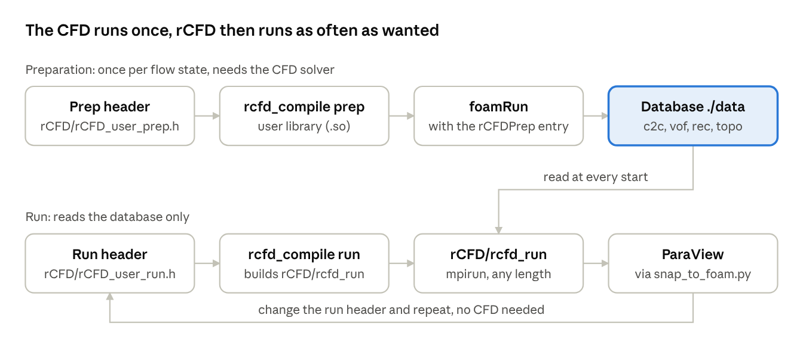

*Figure 1. Workflow, two rows of four steps.*

## 1.2 Installation

One build per machine; after that every case only needs `rcfd_compile`.

### Requirements

- OpenFOAM-13 (or -dev), compiled, environment sourced. OpenFOAM 6 to 12 have a different interface and are refused by `Allwmake`.
- The MPI C compiler wrapper (`mpicc`) of the MPI that OpenFOAM was built with, in the PATH.
- Python 3 with `numpy` for the conversion of results (`sudo apt install python3-numpy`).
- ParaView for looking at results.

### Build

```
source <path to OpenFOAM-13>/etc/bashrc
echo $WM_PROJECT_DIR $WM_PROJECT_VERSION      # must show the v13 installation, version 13 or dev
tar xzf rcfd_foam2.tar.gz
cd rcfd_foam2
./Allwmake 2>&1 | tee log.Allwmake
```

The last lines list what was installed:

| File | Purpose |
| --- | --- |
| `$FOAM_USER_LIBBIN/librcfdOF.so` | rCFD library and the coupling to OpenFOAM (C, MPI) |
| `$FOAM_USER_LIBBIN/librCFDFunctionObjects.so` | function object `rCFDPrep` |
| `$FOAM_USER_APPBIN/rcfd_compile` | builds the user headers of a case |

Object files stay in `rcfd_foam2/build`. Do not move or rename the folder afterwards: `rcfd_compile` uses its sources and objects. After moving it, run `./Allwmake` again.

### Check

```
which rcfd_compile
ls -l $FOAM_USER_LIBBIN/librcfdOF.so $FOAM_USER_LIBBIN/librCFDFunctionObjects.so
```

### Typical problems

- Errors such as `'identityMap' was not declared` with paths containing `OpenFOAM-6`: the shell has an older OpenFOAM loaded. Open a new terminal, source v13 only, build again.
- Other MPI compiler wrapper: `RCFD_CC=mpiicc ./Allwmake`.
- Another version of the rCFD library: replace the files in `rcfd_foam2/lib`, run `./Allwmake`, then `rcfd_compile` in every case.

## 1.3 Preparation mode, starting from any case

The preparation writes the recurrence database while your CFD case runs; you add one folder with a header and one entry to the case, nothing else changes.

### Step 0: what the case must offer

- A solver that carries every phase you want to record as an Eulerian phase with its own flux field. For `multiphaseEuler` these are `alpha.<phase>`, `alphaRhoPhi.<phase>` and `rho.<phase>`. Other solvers and single-phase cases: section 1.7.
- A static mesh. Periodic sides without rotation are supported from release r4 (cyclic patches, non-conformal couples); other coupled patches apart from processor patches are refused.
- A case that runs on its own. Decide the end of the spin-up (statistically steady state) before recording.
- For a parallel run: the decomposition you will also use for the rCFD run. The database is specific to the number of processors.

### Step 1: get the two user headers

In the case directory:

```
rcfd_compile -templates
```

This copies `rCFD_user_prep.h` and `rCFD_user_run.h` into `./rCFD`. Existing files are never overwritten. You can equally copy headers from another case.

### Step 2: edit `rCFD/rCFD_user_prep.h`

The functions and calls are those of the Fluent preparation header. The entries that matter:

```
enum{ ph_gas, ph_solid, number_of_phase_names };      /* order = phases (...) in system/functions */

void user_set_solver_dict(void *handle)
{
    rcfd_set_dict_property_r(handle, "Solver_Dict", -1, -1, -1, "global_time_step", 0.025);   /* frame interval [s] */
    rcfd_set_dict_property_i(handle, "Solver_Dict", -1, -1, -1, "number_of_frames", 80);
    rcfd_set_dict_property_i(handle, "Solver_Dict", -1, -1, -1, "number_of_phases", number_of_phase_names);
    rcfd_set_dict_property_i(handle, "Solver_Dict", -1, -1, -1, "interpolation_on", 1);
    rcfd_set_dict_property_r(handle, "Solver_Dict", -1, -1, -1, "vof_cutoff_limit", 1.0e-6);
}
```

| Property | Meaning | How to choose |
| --- | --- | --- |
| `global_time_step` | frame interval = rCFD time step | Long enough that material moves about one cell or more per frame. Tested: 0.025 s and 0.01 s on 5 mm cells at 0.5 to 0.75 m/s. The log prints the rms displacement per frame, compare it with your cell size. |
| `number_of_frames` | length of the database | Recording window = frames x interval. It should cover several periods of the slowest motion you need (bubbling, sloshing, impeller revolutions). |
| `number_of_phases` | phases recorded | Must equal the number of names in `phases (...)`. |
| `interpolation_on` | 1: up to four source cells per cell instead of one | 1 is the setting of all tests. |
| `vof_cutoff_limit` | cells of a phase below this fraction get no shift | 1e-6 as in the Fluent set-ups. |
| `Phase_Dict` density, number of data | not stored in the database | Set them as in the run header for consistency. |
| `Rec_Dict` format | `replay`: frames are played in recorded order and loop | Used in all tests. |

Two properties are set by the coupling and need not be in the header: `shifts_from_displacement_fields_on = 1` and `time_steps_per_monitoring_interval = 1`. `user_set_cell_dict` and `user_set_face_dict` keep their calls to `fluent_set_cell_dict` and `fluent_set_face_dict`; here these take the counts of the OpenFOAM mesh.

### Step 3: add the function object

Append to `system/functions` (create the file if the case has none; inside `functions { }` of `controlDict` works too):

```
rCFDPrep1
{
    type            rCFDPrep;
    libs            ("librCFDFunctionObjects.so");

    phases          (air particles);    // order = phase index in the user headers
    recordStart     2.0;                // s, end of the spin-up
}
```

The entry must not sit at the top level of `controlDict`; there it is ignored without a message. Do not add `executeControl` or `writeControl`: the labels have to be advanced every time step.

| Optional entry | Default | Meaning |
| --- | --- | --- |
| `userLibrary` | `rCFD/librCFD_user_prep.so` | library built from the prep header |
| `fields { <phase> { alpha ..; flux ..; rho ..; } }` | `alpha.<phase>`, `alphaRhoPhi.<phase>`, `rho.<phase>` | other field names; `none` where a field does not exist |
| `normPhase` | last phase | phase whose volume fraction is the recurrence norm |
| `divScheme` | `"Gauss limitedLinear 1"` | convection scheme of the labels |
| `solver { }` | PBiCGStab, DILU, tolerance 1e-10 | linear solver of the label equations |
| `residualAlpha` | 1e-6 | keeps a label where its phase is absent |
| `writeFields` | no | yes: writes `rCFDdisplacement.<phase>` at write times, the displacement over the last frame |
| labelMaxCo | 1 | Courant number above which a solver time step is divided into sub-steps for the labels (from r3); 0.5 for rotating zones and solvers that run at large Courant numbers |
| maxLabelSubCycles | 200 | largest number of label sub-steps per solver time step; the log says when it limits |

### Step 4: check `system/controlDict`

- `endTime` at least `recordStart` + frames x interval.
- `adjustTimeStep yes`: the function object cuts the time step so that every frame time is met exactly. With a fixed time step choose one that divides the frame interval; otherwise frames are taken late and a warning appears.
- `writeInterval`: rCFD needs no time directories. A long interval saves disk space.

### Step 5: compile the prep header

```
rcfd_compile prep          # -> rCFD/librCFD_user_prep.so
```

Repeat after every change of the header.

### Step 6: run the CFD

Serial:

```
foamRun > log.foamRun 2>&1
```

Parallel:

```
decomposePar
mpirun -np 4 foamRun -parallel > log.foamRun 2>&1
```

Spin-up and recording can be two runs: run the spin-up without the entry, add the entry with `recordStart` equal to the restart time, set `startFrom latestTime` and run again. The recording then starts with the first time step.

### Step 7: check the log

```
grep "rCFDPrep\|database written" log.foamRun
```

Expected, in this order:

```
rCFDPrep rCFDPrep1: opening the rCFD library (6000 cells, phases: air particles, user library rCFD/librCFD_user_prep.so)
rCFDPrep rCFDPrep1: 80 frames of 0.025 s from t = 2 s (rCFD_user_prep.h)
rCFDPrep rCFDPrep1: recording starts at t = 2 s
[rcfd_of] frame   12/80: phase 0: 6000 primary, 17923 total shifts (285 from other ranks), displacement rms/max 9.04/32.66 mm | phase 1: ...
[rcfd_of] database written: 80 frames; phase 0: ... shifts (... from other ranks); phase 1: ...
rCFDPrep rCFDPrep1: database complete at t = 4 s (80 frames, ...). The simulation can be stopped.
```

What to look at in the frame lines:

- **displacement rms/max**: of the order of velocity x frame interval, and not far below the cell size.
- **from other ranks**: not zero in a parallel run where material crosses processor boundaries.
- **primary**: number of cells in which the phase is present (above the vof cutoff).

### What the preparation writes into the case

| Path | Content |
| --- | --- |
| `data/c2c/c2c_0_<phase>_<rank>` | cell-to-cell shifts of every frame, per phase and processor |
| `data/vof/vof_0_<phase>_<rank>` | volume fractions of every frame (not for a single phase without vof) |
| `data/rec/jump_0_0_0` | recurrence path: which frame follows which |
| `data/tmp/norm_0_<rank>` | recurrence norms |
| `data/topo/topo_<rank>`, `gid_<rank>.bin`, `cell_rank.bin`, `meta.txt` | cells, faces and neighbours of every processor for the run mode; global cell numbers |
| `data/rcfd_db.meta.toml` | number of processors, frames, file formats |
| `data/rcfd_foam_prep.txt` | frame interval, frames, phase names; the run program checks its header against it |
| `rCFD_prep.trn`, `post/` | transcript and dump folder of the library |

The database is complete as soon as the log says so; the CFD may continue or be stopped. A run that ends before the last frame leaves an unusable database and says so.

## 1.4 Run mode

The run program holds no model: phases, species, drift, diffusion, balances, initial state, sources and monitors all come from `rCFD/rCFD_user_run.h`. It needs the database in `./data` and no CFD.

### Step 1: edit `rCFD/rCFD_user_run.h`

The header has the functions of a Fluent run header. The example models gas with one data and solids with size classes that drift vertically.

| Function | When the library calls it | What you set there |
| --- | --- | --- |
| `user_set_solver_dict` | initialisation | `global_time_step`, `number_of_frames`, `number_of_phases` (as in the preparation), `vof_cutoff_limit`, switches such as `data_drifting_on`, `local_diff_on`, `control_conc_sum_on` |
| `user_set_phase_dict` | initialisation | per phase: `number_of_data` (number of species), `density` |
| `user_set_rec_dict` | initialisation | recurrence format, `replay` |
| `user_set_data_dict` | initialisation | per species: `type` (`concentration`, `temperature`, `generic`), `face_swap_diffusion`, `drifting_data`, `d1_diam`, `drift_velocity` |
| `user_set_balance_dict` | initialisation | per species: `max_correction_loops` of the mass balance correction (0 switches it off) |
| `user_init_data` | initialisation | initial value of every species in every cell |
| `user_access_data_before_phase_loop` | every step, before the phases | sources, reactions, coupling between phases |
| `user_access_data_before_shift` | every step and phase, before the convection | per-phase changes before transport |
| `user_access_data_after_swap` | every step and phase, after convection, diffusion and drift | per-phase changes before the balance correction |
| `user_post` | initialisation and end of every step | monitors, output arrays |
| `user_register_functions` | once | `REGISTER_RCFD_UDF(...)` for every function above that the header defines |

Access to the data inside these functions, as in Fluent:

```
int      n     = rcfd_get_int_cell_count(handle, i_layer);        /* cells of this processor            */
double **c     = rcfd_get_cell_data(handle, i_layer, i_phase);    /* c[i_cell][i_data]                  */
double **vof   = rcfd_get_cell_vof(handle, i_layer, i_frame);     /* vof[i_cell][i_phase], current frame */
double **x     = rcfd_get_cell_center(handle, i_layer);           /* x[i_cell][0..2]                    */
double  *vol   = rcfd_get_cell_volume(handle, i_layer);
double   rho   = rcfd_get_phase_density(handle, i_phase);
double   t     = rcfd_get_time(handle);
int      frame = rcfd_get_current_frame(handle);
```

A mass source that the balance correction should respect is announced with `rcfd_set_balance_mass_source_one(handle, i_phase, i_data, mass)`.

### Changing the number of species

In the example header only three lines change:

```
#define _number_of_particle_fractions   3

static const double Diameter[_number_of_particle_fractions]      = {0.0012, 0.0022, 0.0033};   /* [m] */
static const double Mass_fraction[_number_of_particle_fractions] = {0.3, 0.4, 0.3};            /* initial */
```

`user_set_phase_dict` passes the count to `number_of_data`, and the loops in `user_set_data_dict`, `user_init_data` and `user_post` run over it. For a different model (reaction, granulation, residence time tracer) add or replace data in the phases and write the access functions as in the corresponding Fluent header.

The drift of the example: `u_i = -k_d (d_i - d32) |d_i - d32|` along `_vert`. `_k_diam 0` switches drift off. `_tracer_height` above zero starts a mixing test instead: class 0 below that height, the last class above.

### Step 2: compile

```
rcfd_compile run           # -> rCFD/rcfd_run
```

Repeat after every change of the header.

### Step 3: run

```
mpirun -np 4 rCFD/rcfd_run -steps 800 -snap 10 > log.rcfd_run 2>&1
```

| Option | Default | Meaning |
| --- | --- | --- |
| `-steps N` | 100 | number of rCFD time steps; simulated time = N x `global_time_step` |
| `-snap K` | 10 | snapshot every K steps; 0 writes only the first and the last |
| `-case DIR` | current directory | case directory |

The number of processes must be the number of the CFD run that wrote the database (1 for a serial run: `rCFD/rcfd_run -steps 800`). The run replays the frames in a loop, so it can be far longer than the recorded window.

### Step 4: check

```
grep "run (rCFD\|run finished\|ERROR" log.rcfd_run
```

```
[rcfd_of] run (rCFD_user_run.h): 4 ranks, 6000 cells, 80 frames of 0.025 s; phases: air (1 data) particles (2 data); 800 steps, snapshot every 10
[rcfd_of] run finished: 800 steps, t = 20 s, 7 fields per snapshot (out/fields.txt); run time 2.43 s (0.0030 s per step) ...
```

### Repeat

Change the header, `rcfd_compile run`, run again. Each run overwrites `out/`, the monitor files and `rCFD_balance.out`; move them away first if you want to keep them.

## 1.5 Output, monitors and ParaView

The run writes binary snapshots to `out/`; one Python call turns them into OpenFOAM time directories that ParaView opens like any OpenFOAM case.

### Files of a run

| File | Written by | Content |
| --- | --- | --- |
| `out/snap_%06d.bin` | run program | all fields of one time step, whole mesh, OpenFOAM cell order |
| `out/fields.txt` | run program | names of the fields in a snapshot, one per line |
| `rCFD_mean_height_monitor.out` (example) | `user_post` of the header | whatever the header monitors; here time, mean height and mass per size class |
| `rCFD_balance.out` | library | per step, phase and species: mass integral and its target |
| `rCFD_run.trn` | library | transcript |
| `rCFD_c2c_step*_node*.txt` | library (diagnostics) | shift lists of the first steps, see section 2.6 |
| `post/` | library | its own VTK dumps, only if a `Dump_Dict` is set; empty otherwise |

### Field names

The part after the dot is the phase; the number after `c` is the species (data) index within that phase.

| Name in `out/fields.txt` | Field in ParaView | Meaning |
| --- | --- | --- |
| `vof.<phase>` | `rCFD_vof.<phase>` | volume fraction of the phase in the current frame |
| `c<i>.<phase>` | `rCFD_c<i>.<phase>` | species i of that phase (mass fraction for type concentration) |
| `<name>` | `rCFD_<name>` | array filled with `rcfd_user_field(handle, "<name>")` in the header |

Example with `phases (air particles)` and two size classes: `rCFD_vof.air`, `rCFD_c0.air` (the gas data), `rCFD_vof.particles`, `rCFD_c0.particles` (class 0), `rCFD_c1.particles` (class 1), `rCFD_vf_diam_0`, `rCFD_vf_diam_1`. The phase names come from the preparation; a database without that information uses `p0`, `p1`.

### Own output arrays (the counterpart of a user-defined memory)

```
double *vf = rcfd_user_field(handle, "vf_diam_0");          /* first call creates it, length = internal cells */
if(vf) for(i_cell = 0; i_cell < int_cell_count; i_cell++)
    vf[i_cell] = data_solid[i_cell][0] * cell_vof[i_cell][solid];
```

Fill it in `user_post`; it is written with every snapshot.

### Convert

```
python3 <path>/rcfd_foam2/py/snap_to_foam.py --run . --case . --out rCFD_results
```

| Option | Meaning |
| --- | --- |
| `--run DIR` | directory that holds `out/` |
| `--case DIR` | case with `constant/polyMesh` (ascii or binary) |
| `--out DIR` | results case to create |
| `--copy-mesh` | copy the mesh instead of linking it. Needed when ParaView runs on Windows and the case lies on a Windows drive (`/mnt/d/...` in WSL): a link made in WSL cannot be read there. |
| `--every K` | convert only every K-th snapshot |

Result: `rCFD_results/<time>/rCFD_*` (text files), `rCFD_results/constant/polyMesh`, `rCFD_results/rCFD_results.foam`. One time step of a 6000-cell case with seven fields takes about 0.4 MB.

### Look

1. In ParaView: File, Open, `rCFD_results/rCFD_results.foam`, Apply.
2. Choose a field in the colour drop-down, for example `rCFD_c1.particles`.
3. Step through time with the play controls. Rescale the colour range to the data over all time steps where needed.

Cells in which a phase is absent keep whatever value their species had; colour by `rCFD_vf_diam_*` (fraction x volume fraction) or threshold on `rCFD_vof.<phase>` to hide them.

### Monitors

The example header writes one line per step to `rCFD_mean_height_monitor.out`: time, mean height of every size class, mass of every size class. Plot it with any tool:

```
gnuplot -p -e "plot 'rCFD_mean_height_monitor.out' u 1:2 w l t 'class 0', '' u 1:3 w l t 'class 1'"
```

## 1.6 Worked example: the fluidisedBed tutorial

`tutorials/multiphaseEuler/fluidisedBed` runs end to end with one script: 2 s spin-up, 80 frames of 0.025 s, then 800 rCFD steps (20 s) on 4 processors.

```
cd rcfd_foam2/tutorial/fluidisedBed
./Allrun                  # 4 processors;  ./Allrun serial
```

The case: 0.15 m x 1 m, 30 x 200 cells of 5 mm, air through particles of 0.3 mm and 2500 kg/m3, inlet velocity 0.25 m/s, decomposed into four slices along the height.

### What `Allrun` does

1. Copies `0`, `constant`, `system` from `$FOAM_TUTORIALS/multiphaseEuler/fluidisedBed` (only if there is no `system` folder yet).
2. Sets `endTime 4` and `writeInterval 0.5` in `system/controlDict` and appends `rCFDPrep.functions` to `system/functions`.
3. `rcfd_compile` builds both headers in `rCFD/`.
4. `blockMesh`, `setFields`, `decomposePar`, `mpirun -np 4 foamRun -parallel`: CFD with preparation.
5. `mpirun -np 4 rCFD/rcfd_run -steps 800 -snap 10`: run mode.
6. `snap_to_foam.py`: results in `rCFD_results`.

For a second run with other settings edit `system/functions` and the headers in `rCFD/` of that folder. `runApplication` skips a step whose `log.*` file exists.

### What to expect

Measured in the test environment (2 cores shared by 4 processes, OpenFOAM built with -O1):

| Quantity | Value |
| --- | --- |
| CFD run to 4 s | about 5 min wall time, about 2100 time steps |
| label transport | 2 % of the CPU time of the CFD run |
| database | 80 frames; 1 230 804 solids shifts, 49 125 of them from other processors |
| solids displacement per frame | 15 to 18 mm rms, up to 46 mm |
| run mode | 800 steps in 2.4 s (3 ms per step) |

The numbers of your run differ in the last digits: the bubbling bed is chaotic and the time-step sequence depends on the machine.

### Two experiments on that database

Both need only the run header, `rcfd_compile run` and a new run.

**Mixing test.** `_tracer_height 0.25` and `_k_diam 0.0`: size class 0 starts below 0.25 m, which is exactly processor 0. The tracer fraction in every processor converges to the overall value 0.369 within about 6 s; the total stays at 0.3687 to 0.3684.

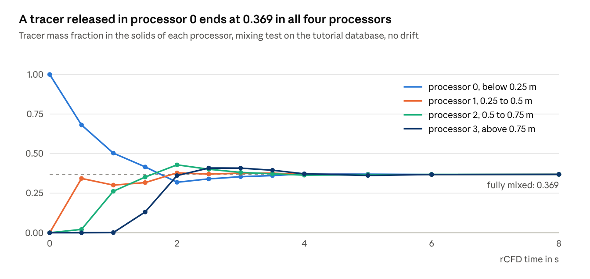

*Figure 2. Run on the tutorial database in the test environment, 4 processors, 12 output times.*

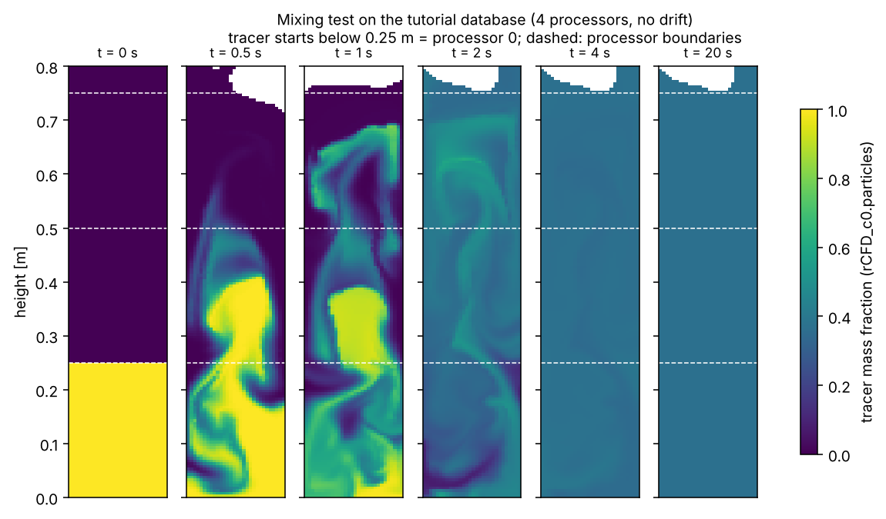

*Figure 3. Tracer mass fraction at six times of the same run; the dashed lines are the processor boundaries. The tracer crosses all three boundaries and no processor keeps a composition of its own.*

**Three size classes with drift.** `_number_of_particle_fractions 3`, diameters 1.2, 2.2 and 3.3 mm, `_k_diam 2.0e5`: the coarse class settles and the fine class rises. The mean heights repeat with the 2 s length of the database.

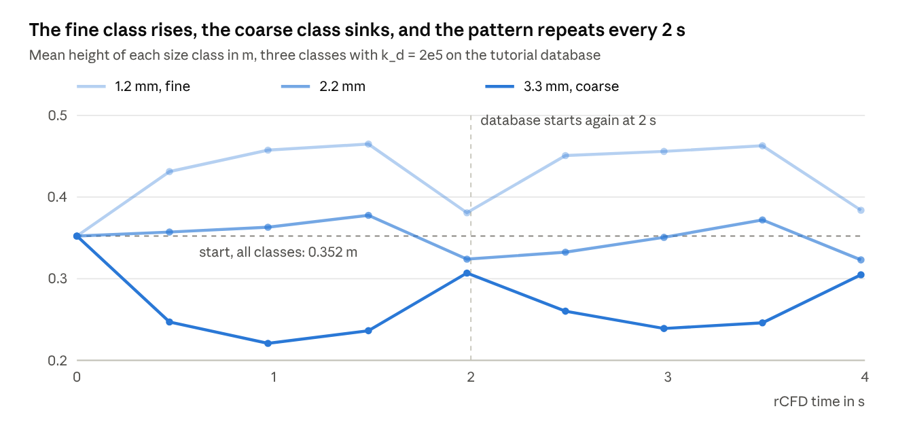

*Figure 4. RCFD_mean_height_monitor.out of the three-class run in the test environment, first 4 s.*

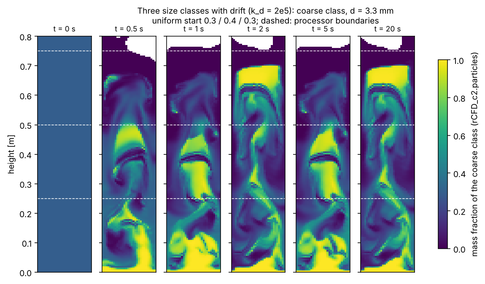

*Figure 5. Mass fraction of the coarse class at six times. 1 s and 5 s look alike, and so do 2 s and 20 s: the state repeats with the 2 s database. With these settings at least one class would drift more than one 5 mm cell per 25 ms step, so the drift is capped (section 3.7). Read the picture as a demonstration that three classes run on this database, not as a validated segregation pattern.*

## 1.7 Other solvers, single phase, Fluent headers

The function object looks fields up by name, so it is not tied to `multiphaseEuler`; it needs a flux field for every recorded phase.

### Other field names

```
rCFDPrep1
{
    type            rCFDPrep;
    libs            ("librCFDFunctionObjects.so");

    phases          (gas solid);
    fields
    {
        gas   { alpha alpha.gas;   flux alphaRhoPhi.gas;   rho rho.gas;   }
        solid { alpha alpha.solid; flux alphaRhoPhi.solid; rho rho.solid; }
    }
    recordStart     2.0;
}
```

| Entry | Accepts | Remark |
| --- | --- | --- |
| `alpha` | a volume fraction field, or `none` | `none`: the phase fills every cell |
| `flux` | a face flux of the phase | mass flux (kg/s) or volume flux (m3/s); recognised by its dimensions |
| `rho` | a density field, or `none` | needed only with a mass flux |

### Single-phase case

For a solver with one fluid and the volume flux `phi` (stirred tank, pipe flow):

```
    phases          (fluid);
    fields
    {
        fluid { alpha none; flux phi; rho none; }
    }
```

In both user headers `number_of_phases` is 1. The library then writes no vof files and the run program reports a volume fraction of one. Tested with a prescribed vortex and a stand-in solver, not with a real single-phase OpenFOAM solver.

### What does not work

A phase without an Eulerian flux cannot be recorded: Lagrangian particles, DEM or CFDEM solids. For those the position labels would have to come from the particles, which this function object does not do.

### Bringing a Fluent user header over

Copy the header to `rCFD/rCFD_user_prep.h` or `rCFD/rCFD_user_run.h` and run `rcfd_compile`. Its first lines stay as they are:

```
#include "udf.h"
#include "rCFD_library.h"
```

`udf.h` is here a small stand-in from the package (`user/udf.h`). It provides:

| From Fluent | Here |
| --- | --- |
| `RP_NODE`, `RP_HOST` | 1 and 0: every process is a compute node |
| `myid`, `node_zero`, `I_AM_NODE_ZERO_P` | MPI rank, 0, rank == 0 |
| `Message`, `Message0` | `printf` on every rank, on rank 0 |
| `PRF_GRSUM1`, `PRF_GRHIGH1`, `PRF_GRLOW1`, `PRF_GISUM1`, `PRF_GIHIGH1`, `PRF_GILOW1` | `MPI_Allreduce` over all ranks |
| `REGISTER_RCFD_UDF(f)` | registers `f` with the library |
| `fluent_set_cell_dict`, `fluent_set_face_dict` | cell and face counts of the OpenFOAM mesh (preparation); nothing to do in run mode |
| `real` | `double` |

What has no counterpart and must be edited:

1. Loops over Fluent threads (`Domain`, `Thread`, `Get_Domain`, `thread_loop_c`, `begin_c_loop`, `C_UDMI`, ...). Put them between `#ifndef RCFD_OPENFOAM` and `#endif`; the same header then still compiles in Fluent. For what the loop displayed, fill a named array with `rcfd_user_field` (section 1.5).
2. User functions the library version in `lib/` does not know (for example `user_set_calibration_dict`). They are reported and ignored.
3. `global_time_step` and `number_of_frames` must fit the database you run on.

The Fluent header `rCFD_user_run_simple.h` needed exactly the first edit in two places (the declarations `Domain *d`, `Thread *t` and the `C_UDMI` loop) and then gave the same result as the example header to 1e-5.

## 1.8 Messages and troubleshooting

Every check stops with a message that names the file to change; the table lists them with the usual cause.

### Build and compile

| Symptom | Cause | Fix |
| --- | --- | --- |
| `Allwmake: this is OpenFOAM '6'` or compile errors with `OpenFOAM-6` in the paths | wrong OpenFOAM environment | new terminal, source v13 only, `./Allwmake` |
| `rcfd_compile: run ./Allwmake in ... first` | package folder moved, or not built | `./Allwmake` in the package folder |
| `rcfd_compile: rCFD_user_run.h did not compile` with `unknown type name 'Domain'` | Fluent thread code in the header | guard it with `#ifndef RCFD_OPENFOAM`, section 1.7 |
| `mpirun was unable to launch ... rCFD/rcfd_run` | run header not compiled | `rcfd_compile run` |

### Preparation (in `log.foamRun`)

| Symptom | Cause | Fix |
| --- | --- | --- |
| no line with `rCFDPrep` at all | entry not inside `system/functions` or `functions { }` | move the entry, section 1.3 step 3 |
| `user library 'rCFD/librCFD_user_prep.so' not found` | prep header not compiled | `rcfd_compile prep` |
| `frameInterval and nFrames are set in the user header` | entry in the format of the first package | remove both from the entry, set them in `rCFD_user_prep.h` |
| `Remove executeControl/writeControl` | time control in the entry | remove it |
| `rCFD_user_prep.h sets number_of_phases = 2, the function object hands over 1 phases` | header and `phases (...)` disagree | make them equal |
| `request for volScalarField alpha.x from objectRegistry failed` | field name does not exist in this solver | `fields { }`, section 1.7 |
| `periodic patches with a rotation are not supported` / `coupled patches other than processor and cyclic patches` | mesh has such patches | not supported |
| `Frame taken at t = ..., ... s after its time` | fixed time step does not divide the frame interval | `adjustTimeStep yes` or a fitting time step |
| `only N of M frames were written. The database is NOT usable` | CFD ended inside the recording window | raise `endTime`, run again |
| `Increased the timePrecision` (OpenFOAM warning) | time step cut to meet `recordStart` | harmless |
| `from other ranks` is zero in every frame of a parallel run | no flow across processor boundaries, or labels not moving | check `displacement rms`; if it is near zero the flux field is wrong |
| No cellProcAddressing in the processor directories | the mesh was made in parallel (snappyHexMesh -parallel) | run reconstructPar once before foamRun |
| only N of M frames were written | the run ended before the recording was complete (end time, or controlDict changed while running) | from r3 the N frames are usable with a replay path: set number\_of\_frames to N in rCFD\_user\_run.h, or rerun |
| displacement rms or max of a frame larger than the vessel | solver Courant number far above 1 (rotating zone, jets) | labelMaxCo 0.5 in the entry rCFDPrep1; check the line 'label Courant number up to ...' of every frame |

### Run (in `log.rcfd_run`)

| Symptom | Cause | Fix |
| --- | --- | --- |
| `the database was prepared on 4 ranks, this run uses 2` | other number of processes | `mpirun -np 4` |
| `rCFD_user_run.h sets number_of_frames = 315, the database holds 40` | header from another case | set `number_of_frames` to the database value or below |
| `sets global_time_step = ..., the database was prepared with a frame interval of ...` | header and database disagree | set `global_time_step` to the frame interval |
| `sets number_of_phases = ..., the database was prepared with ...` | header and database disagree | make them equal |
| `[warning] Balance for i_phase 1 i_data 0 beyond accuracy level` | the balance correction did not reach its target within `max_correction_loops` | expected with `max_correction_loops 0`; otherwise raise the loops or check the model |
| no segregation with drift on | drift velocity too small: `k_d (d - d32)^2`. With d - d32 = 50 um and k\_d = 100 it is 2.5e-7 m/s | choose k\_d for the velocity you want; 2e7 gives 0.05 m/s here |
| checkerboard patterns with drift | probably a drift per step larger than a cell (not investigated further): velocity x `global_time_step` > cell size | smaller k\_d or a shorter frame interval |

### Results

| Symptom | Cause | Fix |
| --- | --- | --- |
| ParaView on Windows cannot read the mesh of `rCFD_results` | mesh is a link made in WSL | `snap_to_foam.py ... --copy-mesh` |
| a field shows 1e-38 everywhere | species that is zero (for example the gas data of the example) | choose the species of the phase you mean, section 1.5 |
| fields are called `rCFD_c0.p1` | database written by the first package, phase names unknown | `p0`, `p1` are the phases in header order |
| a change in rCFD\_user\_run.h has no effect (for example a new initial state) | the header was not compiled again: rCFD/rcfd\_run is older than the header | rcfd\_compile run, then run again. From package r2 on, rcfd\_run and foamRun stop with a message in this case (cksum of the header stored in the build) |
| the initial state (time 0) is missing in ParaView | the OpenFOAM reader of ParaView skips time 0 by default | untick Skip Zero Time in the Properties of the .foam file, Apply |
| no segregation although drift is on | drift velocity k\_d (d - d32)\|d - d32\| far below the mixing velocity of the bed; with 50 micrometre difference and k\_d = 2e5 it is 0.5 mm/s | compute the drift velocity of every class first; visible segregation in the tutorial bed needs centimetres per second |

## 1.9 Second example: a species in the gas of an aerated stirred tank

Package r3 adds `tutorial/aeratedStirredTank`. It uses the OpenFOAM tutorial `multiphaseEuler/aeratedStirredTankMRF`: gas and liquid, an impeller as a rotating zone (MRF) at 500 rpm, a mesh of about 250 000 cells from `snappyHexMesh`, gas fed at the sparger (patch `inlet`) and leaving at the top (patch `outlet`). The species is carried by the gas: 1 in the gas that enters at the sparger, 0 in the gas that is in the tank at the start.

### Run it

```
cd rcfd_foam2/tutorial
cp -r aeratedStirredTank aeratedStirredTank_test
cd aeratedStirredTank_test && ./Allrun test       # the chain on 8 frames of the start-up
cd ../aeratedStirredTank && ./Allrun              # the tutorial to 15 s, 40 frames from 14 s
```

`./Allrun test` records 8 frames between 0.05 s and 0.25 s with the gas switched on at 0.05 s and runs 7 rCFD steps. The flow is the start-up of the stirrer, so it is a test of the chain and not a result. `./Allrun` runs the tutorial as it is, records 40 frames of 0.025 s in the last second and then runs 2000 rCFD steps (50 s).

### What is different from the fluidised bed

| Point | What to do |
| --- | --- |
| Mesh made in parallel by `snappyHexMesh` | run `reconstructPar` once before `foamRun`, as the tutorial does: it reconstructs the mesh and writes the cell addressing that numbers the cells of the database. The function object stops with this advice if the addressing is missing. |
| Rotating zone (MRF) | inside the zone the solver transports with the flux relative to the rotor, and so do the labels: material moves by the rotor speed relative to the mesh, 54 to 75 degrees per 25 ms here. Set `labelMaxCo 0.5` in the entry `rCFDPrep1`. |
| `maxCo 40` in the tutorial | nothing in `controlDict`: the labels are advanced in sub-steps (section 2.4). The log line `label Courant number up to 36, up to 73 label sub-steps per time step` shows it. |
| Gas enters and leaves | the run header sets the cells at the inlet every step and lets the target of the mass balance follow the mass in the tank (below). |

### The inlet in the run header

`rcfd_patch_faces` is the counterpart of a face loop over a boundary thread in Fluent. It returns the faces of a boundary patch that lie on this processor:

```
const int *cells;
int i, n = rcfd_patch_faces(handle, "inlet", &cells, NULL, NULL);

for(i = 0; i < n; i++) data_gas[cells[i]][tracer] = 1.0;
```

`n` is -1 if the database has no patch of that name (the log then lists the names), `cells[i]` is the cell next to face i. The fourth and fifth argument return the face areas and face centres. The header calls this in `user_access_data_before_shift` and again in `user_access_data_after_swap`. The cells at an inlet take their content from themselves in the shift, so the value set there is what the gas carries into the tank.

### A species that is not conserved

The mass balance of the library keeps the mass of every species at its start value. For a species that enters and leaves, the header sets the target to the current mass in every step, in `user_access_data_after_swap`:

```
for(i_cell = 0; i_cell < int_cell_count; i_cell++)
    mass += data_gas[i_cell][tracer] * cell_volume[i_cell] * cell_vof[i_cell][gas] * _density_gas;

rcfd_set_balance_mass_integral_target(handle, gas, tracer, mass);
rcfd_set_balance_mass_integral_target_global(handle, gas, tracer, PRF_GRSUM1(mass));
```

Without these lines the correction pulls the mass towards the start value: in the test about half of the species fed was taken out again (1.5 g instead of 3.3 g in the tank after 7 steps), with a balance warning in every step.

### Output

| File or field | Content |
| --- | --- |
| `rCFD_c0.gas` | the species (mass fraction in the gas) |
| `rCFD_vf_tracer` | species times gas volume fraction: zero where there is no gas, the field to look at |
| `rCFD_vof.gas`, `rCFD_vof.liquid` | volume fractions of the current frame |
| `rCFD_gas_tracer_monitor.out` | time, species mass in the tank, gas mass in the tank, mean species fraction in the gas, species fraction in the cells at the outlet |

### What the test in my workspace showed

Run: the OpenFOAM-13 tutorial on 4 processors, 254 464 cells, 8 frames of 0.025 s from 0.05 s, gas switched on at 0.05 s.

| Check | Result |
| --- | --- |
| cell numbering of the snapshots | `rCFD_vof.gas` equals OpenFOAM's `alpha.gas` in the reconstructed mesh to 8e-8, at two times |
| gas tagged at the inlet per rCFD step | 0.43 to 0.47 L against 0.467 L fed by the CFD (first step: 0.10 L, the cells next to the inlet are not tagged yet) |
| plume below 0.3 m after 7 steps | 94 % of the gas is tagged; 79 % of the cells with gas are above 0.9, none below 0.1 |
| gas drawn down from the head space along the shaft | stays at 0, as it should |
| labels in the rotating zone | without sub-steps useless (origin points up to 12 m away, 6094 outside the tank); with `labelMaxCo 0.5` no origin outside the tank, rotation 54 degrees per frame in the median |
| cost of the recording | 27 min for 8 frames on 2 cores: about 100 s per frame for the label sub-steps and 56 to 97 s per frame for the search of the source cells, against 25 s for the CFD of that frame |
| rCFD run | 0.07 s per step |

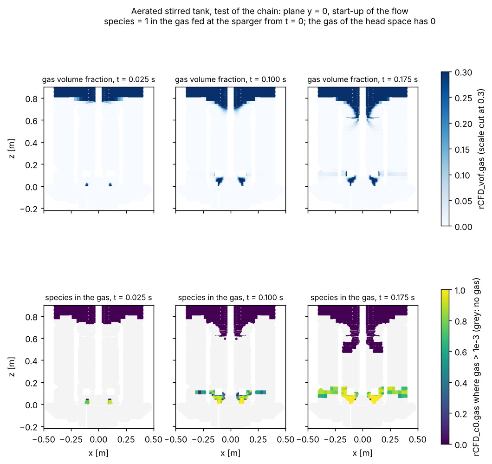

*Figure 12. Test run in my workspace, plane y = 0. Top: gas volume fraction of the frames. Bottom: the species where there is gas. The gas from the sparger ring is tagged and thrown outwards by the lower impeller; the head-space gas drawn down at the shaft is not.*

Not tested: the tutorial at its steady state (15 s), a database of 40 frames, a long rCFD run, the outlet. The frame interval of 0.025 s is the tested value, not an optimised one: during the start-up the liquid in the bulk moved about a sixth of a cell per frame, which makes the transport there diffusive (section 3.7).

## 1.10 Third tutorial: reactions on a frozen flow

Package r4 adds `tutorial/latticeReactions`. A liquid flows steadily through a lattice that is periodic in x and y; species A reacts at the lattice wall to B, and B reacts on to C, D and E. The tutorial answers one question: if the flow field is known, how well does rCFD reproduce transport, diffusion and reactions on it, and at what cost?

### Run it

```
cd rcfd_foam2/tutorial/latticeReactions
./Allrun                 # mesh, steady flow, recording, rCFD run of 4 s; 4 processors, about 8 min
./Allrun nonConformal    # the same with non-conformal periodic sides
./Allrun step 0.005      # afterwards: record and run again with another frame interval [s]
./Allrun reference       # afterwards: OpenFOAM solves the species on the same flow (7 min)
./Allrun clean
```

`README.md` in the folder lists the files of every step.

### What is different from the other two tutorials

| Topic | Here |
| --- | --- |
| Flow | Steady, single phase. Solved once with `incompressibleFluid` (`system.flow`). |
| Recording | On the frozen flow: `solver functions; subSolver incompressibleFluid;` in `system.record/controlDict` reads the converged fields and runs only `rCFDPrep`. Two frames; the run replays them. |
| Periodic sides | `cyclic` patches, or non-conformal couples made by `createNonConformalCouples`. The log names the patches, the planes and the number of image cells (section 2.9, release r4). |
| Diffusion | In the run header, in sub-steps, across all faces: `rcfd_face_distance` and `rcfd_update_corona`. The face swap of the library is switched off. |
| Wall reaction | In the cells that touch the patch `reactingWall` (`rcfd_patch_faces`), in the same sub-steps as the diffusion. |
| Mass balance | Open system: the targets are set to the current content every step, as in the stirred tank. |

### Diffusion and reactions in the run header

The wall reaction is far faster than the transport to the wall, so the two cannot be split over a whole rCFD step: diffusion once per step and reaction once per step gives the wrong conversion. `diffuse_and_react` in `rCFD/rCFD_user_run.h` runs both in sub-steps, called from `user_access_data_after_swap`:

```
n_faces = rcfd_get_face_count(handle, i_layer);
c0 = rcfd_get_face_c0(handle, i_layer);  c1 = rcfd_get_face_c1(handle, i_layer);
area = rcfd_get_face_area(handle, i_layer);
rcfd_face_distance(handle, &distance);          /* distance of the two cell centres of every face */

conductance[i_face] = _diffusivity * |area[i_face]| / distance[i_face];

for every sub-step:
    rcfd_update_corona(handle, fluid);          /* copies of the cells of the neighbour processors */
    for every face:    q = conductance * dt_sub * (data[c1] - data[c0]);   c0 gains q, c1 loses q
    for every cell:    data += change / cell_volume;   then the reactions over dt_sub
```

The faces across a processor boundary and across a periodic side are in the same list; `rcfd_face_distance` returns the true distance across a periodic side. The number of sub-steps follows from `_max_diffusion_number` (0.25) and the smallest cells; the run prints it once. Here it is 8 sub-steps of 2.5 ms per step of 20 ms.

### What to expect

Mean mass fractions in the cells at the outlet after 4 s, 4 processors, test environment:

| Frame interval | A | C | D | E | Run time |
| --- | --- | --- | --- | --- | --- |
| Reference: OpenFOAM, steps of 2 ms | 0.0052 | 0.1752 | 0.3404 | 0.4765 | 392 s |
| 100 ms | 0.0086 | 0.1653 | 0.3571 | 0.4665 | 27 s |
| 50 ms | 0.0103 | 0.1729 | 0.3463 | 0.4683 | 33 s |
| 20 ms | 0.0077 | 0.1727 | 0.3469 | 0.4702 | 43 s |
| 10 ms | 0.0041 | 0.1652 | 0.3546 | 0.4725 | 62 s |
| 5 ms | 0.0029 | 0.1583 | 0.3657 | 0.4678 | 88 s |

The products are within 0.03 of the reference for every frame interval. 20 to 50 ms is the best range: the liquid moves 1 to 4 cells per frame in the lattice. Shorter frames do not improve the result. The interpolation of the library uses the source cell and its face neighbours, the shifts then carry a little less than the full displacement where the origin lies close to the cell itself, and that error adds up over more steps. Cyclic and non-conformal sides give the same outlet values to four digits.

### A case of your own

1. Converged steady flow in OpenFOAM-13. A mesh with `cyclicAMI` sides from another OpenFOAM version: set the side patches to `type patch` in `constant/polyMesh/boundary` and couple them with `createNonConformalCouples` (`system.flow/createNonConformalCouplesDict`; `separation` is the position of the first patch minus the position of the second).
2. `system.record` and `rCFD/` from the tutorial. In `rCFD/rCFD_user_run.h`: patch names, flow rate, density, rate constants.
3. A frame interval in which the liquid moves one to a few cells in the region of interest.
4. Cost. Recording: the library searches the source cells by brute force inside each processor, minutes per frame for 250 000 cells per processor. Memory: tables over all cells on every processor for a short time, about 75 bytes per cell of the whole mesh. Run: the diffusion sub-step scales with the square of the smallest cell size.

## 1.11 Fourth example: the 16 million cell lattice on the cluster

`tutorial/fischerK_of13` is the lattice case of the reacting OpenFOAM v2512 study (`fischerK_a1_0_b1_0_c1_0`) brought to OpenFOAM-13 and rCFD. The aim is the question of section 1.10 on the real mesh: with the flow field known, how well and how fast does rCFD give the species fields, where the reacting solver needs days?

### The case

| Item | Value |
| --- | --- |
| Mesh | 16 263 262 cells from `snappyHexMesh` (v2512), wall layers down to about 1 µm, smallest cell 7.8e-17 m3; the four sides are periodic and do not match face by face |
| Flow | liquid, 992.25 kg/m3, 0.6527 mPa s, 1 mL/s from z = -10 mm to z = 25 mm, steady and laminar |
| Reactions | A -> B at the wall patch `reactingWall` (the lattice surface between z = 0 and 10 mm), B -> C, C -> D, 2 B -> E; rates as in section 1.10 |
| Diffusion | D = 6.578e-7 m2/s for all species (Schmidt number 1, as the reacting solver does) |

### Two jobs

| Job | Steps | Measured on 64 processes |
| --- | --- | --- |
| `job1_flow.sbatch` | Copies the mesh from the v2512 case (read only), turns the four `cyclicAMI` patches into ordinary patches and couples them with `createNonConformalCouples`, `decomposePar`, `checkMesh`, steady flow with `incompressibleFluid`. | Coupling: average coverage 0.9999. Flow converged in 614 iterations, 595 s. |
| `job2_rcfd.sbatch` | Recording on the frozen flow (two frames of 10 ms, `system.record`), then `rcfd_run` with `rCFD/rCFD_user_run.h`, then `snap_to_foam.py --binary`. A second submission skips the recording. | Test of 20 steps done; full run of 500 steps (5 s) open. |

```
sbatch fischerK_of13/job1_flow.sbatch
sbatch --export=ALL,STEPS=20,SNAP=0 fischerK_of13/job2_rcfd.sbatch     # test: recording and 20 steps
sbatch fischerK_of13/job2_rcfd.sbatch                                  # 500 steps = 5 s, a snapshot every 1 s
```

`STEPS` is the number of rCFD steps of 10 ms, `SNAP` the number of steps between two snapshots; `SNAP=0` writes none.

### Why the diffusion step is implicit here

The explicit exchange of section 1.10 needs a sub-step below `0.25 V / sum(D A / d)` of the smallest cell. With wall cells of 1 µm that is less than a microsecond. `_diffusion_in_header 2` solves diffusion and the wall reaction implicitly, `_implicit_substeps` (4) times per rCFD step; the log prints the number of solver iterations per species.

### Output

| File | Content |
| --- | --- |
| `rCFD_lattice_monitor.out` | per step: time, mean A B C D E in the cells at the outlet, mass of A B C D E in the domain [kg] |
| `rCFD_lattice_profile.out` | latest state: z, volume-weighted mean A B C D E in layers of 0.5 mm, volume of the layer. Compare with the plane averages of the reacting case. |
| `rCFD_lattice_profile_history.out` | the same every 10 steps, one block per time |
| `out/snap_*.bin`, `rCFD_results/<time>/` | fields of all cells at the snapshot times, for ParaView (`rCFD_results/rCFD_results.foam`) |

Fields in `rCFD_results/<time>/`:

| Field | Meaning |
| --- | --- |
| `rCFD_c0.fluid` ... `rCFD_c4.fluid` | mass fractions of A, B, C, D, E |
| `rCFD_wall_rate` | A converted to B at the reacting wall in this cell [1/s]; zero away from the wall. Shows which parts of the lattice surface work. |
| `rCFD_share_E` | share of the B reacting at this moment that becomes E, `k_BE B / (k_BC + k_BE B)`. High where B is concentrated. |
| `rCFD_sel_CD` | (C + D) / (C + D + E): share of the products that took the path B -> C -> D |

### Times to expect

| Process | Time |
| --- | --- |
| Liquid from the inlet to the lattice (10 mm at 0.01 m/s) | 1 s |
| Mean residence time of the whole domain (2.75 mL at 1 mL/s) | 2.75 s |
| B -> C | 0.1 s |
| C -> D | 1 s |
| 2 B -> E | 0.02 s at B = 1, 0.2 s at B = 0.1, 2 s at B = 0.01 |

In the test of 20 steps (0.2 s) species A had moved 2.2 mm into the inlet section and no reaction had started: the liquid reaches the reacting wall after about 1 s. The mass of A in the domain grew by 9.8e-6 kg per step; the inflow is 992.25 kg/m3 x 1e-6 m3/s x 0.01 s = 9.9e-6 kg.

# Part 2 — From Fluent to OpenFOAM: what was built

## 2.1 Starting point and reason

The rCFD library itself is solver-neutral C; only a thin layer tied it to Fluent. The port replaces that layer and leaves the library as it was.

### How rCFD sits in Fluent

| Part | File | Role |
| --- | --- | --- |
| library | `rCFD_library.c` with the `rCFD_*.h` headers, `tomlc17.c` | shifts, recurrence, run-time step, balances, parallel exchange; called through the `rcfd_...` functions |
| Fluent glue, preparation | `rCFD_C2C_prep.c`, `rCFD_fluent.h` | `DEFINE_` macros; reads cells, faces and partition neighbours from Fluent threads; hands volume fractions and the user-defined scalars that carry the position labels to the library |
| Fluent glue, run | `rCFD_C2C_run.c` | calls `rcfd_run` per time step, copies results to user-defined memories |
| user headers | `rCFD_user_prep.h`, `rCFD_user_run.h` | dictionary settings and model code, compiled into the UDF library |
| journals | `rcfd_prep.scm`, `rcfd_run.scm` | drive Fluent: time stepping, calls of the on-demand functions |

In the preparation Fluent transports three user-defined scalars per phase with the mass flux of that phase. They start as the cell coordinates, so after one frame interval the scalar of a cell says where its material came from. The library turns these position labels into cell-to-cell shifts.

### What went wrong in the replay route

The CFD-DEM results (CFDEM, OpenFOAM 6) were brought into Fluent as interpolation files and the labels were transported there. Diagnostics added to the library (the `[c2c]` printout, section 2.6) showed on the 16-partition database:

- of about 400 000 solids shifts per frame only 59 to 431 took their data from another partition;
- 58 to 87 % of the solids mass of a partition was filled from cells more than 20 mm away, up to the size of the partition, while the DEM particles move about 12.5 mm in 25 ms;
- the pattern of source cells was a shrunken image of each partition, the same in every frame.

The reason: the interpolation files hold volume fractions and cell velocities, but the labels were transported with the face flux of the Fluent solver, which is not part of the interpolated data. Each partition became a closed box stirred over its whole size, which is the locking of size classes in partitions. Databases prepared natively in Fluent do not show this, because there the flux belongs to the solution.

### Decisions on the way

1. A repair of the Fluent replay was written (labels from back-traced cell velocities) but not run in Fluent.
2. A file-based OpenFOAM chain followed: Python read time directories, back-traced the origins and wrote frame files for a standalone preparation program. It worked on synthetic cases and served later as an independent reference.
3. The requirement then became: rCFD inside the OpenFOAM run, as in Fluent, without intermediate files. That is the function object `rCFDPrep` of the first package (`rcfd_foam`).
4. The second package (`rcfd_foam2`) restored the Fluent workflow: user headers for preparation and run, one compile command, a general run program.

## 2.2 Architecture

Every Fluent-specific part has one counterpart; the library and the form of the user headers are common to both worlds.

| Task | Fluent | OpenFOAM |
| --- | --- | --- |
| transport of the position labels | user-defined scalars, solved by Fluent with the phase mass flux | three `volScalarField`s per phase, solved by the function object with `alphaRhoPhi.<phase>` |
| hook into the time loop | `DEFINE_ADJUST`, `DEFINE_EXECUTE_AT_END`, on-demand UDFs called by the journal | `functionObject::execute()` once per time step, `timeToNextAction()` for the frame times |
| mesh and partition neighbours | `rCFD_fluent.h` reads threads and exterior cells | `rCFDPrep::open()` reads `fvMesh` and the processor patches |
| calling the library in preparation | `rCFD_C2C_prep.c` | `rcfd_of_bridge.c` |
| user header to library | compiled into the UDF library, `user_register_functions` | compiled by `rcfd_compile` into `librCFD_user_prep.so` and into `rcfd_run`, same `user_register_functions` |
| run mode host | Fluent process with `rCFD_C2C_run.c` | standalone MPI program `rcfd_run` (`rcfd_run_main.c`) |
| showing results | user-defined memories, Fluent contours | snapshots, `snap_to_foam.py`, ParaView |
| Fluent macros used by headers | `udf.h` of Fluent | `user/udf.h` of the package |

In the preparation three pieces of code live in the `foamRun` process: the function object (C++, in `librCFDFunctionObjects.so`), the coupling with the library (C, in `librcfdOF.so`) and the compiled user header (`librCFD_user_prep.so`, loaded at run time). In run mode one executable holds the run program, the library and the compiled run header.

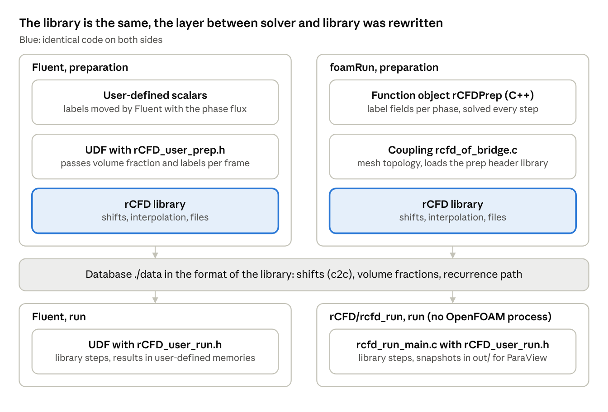

*Figure 6. Fluent and OpenFOAM side by side, preparation above and run below.*

## 2.3 Inventory of files

The package holds about 5400 lines of new code next to the 33 800 lines of the library; nothing of Fluent is needed.

### New files

| File | Lines | Language | Purpose |
| --- | --- | --- | --- |
| `functionObject/rCFDPrep.H`, `rCFDPrep.C` | 236 + 914 | C++ | function object: label fields and their transport, topology of each processor from `fvMesh`, frame timing, hand-over to the coupling |
| `functionObject/Make/files`, `Make/options` | 3 + 9 | wmake | build of `librCFDFunctionObjects.so`, linked with `finiteVolume`, `meshTools`, `librcfdOF.so` |
| `src/rcfd_of_bridge.h`, `rcfd_of_bridge.c` | 102 + 832 | C | coupling for the preparation: `rcfd_of_prep_open`, `_frame`, `_close`; loads the user library; checks the topology; writes `data/topo` |
| `src/rcfd_of_common.h` | 906 | C | shared helpers: topology reader and checks, user functions that give the topology to the library, messages, little-endian i/o |
| `src/rcfd_run_main.c` | 570 | C | general run program: database checks, registration of the run header, time loop, snapshots, `rcfd_user_field` |
| `user/udf.h` | 80 | C | stand-in for the Fluent header: `RP_NODE`, `myid`, `Message`, `PRF_G...`, `REGISTER_RCFD_UDF`, `fluent_set_cell_dict`, `rcfd_user_field` |
| `user/rcfd_user_wrap.c` | 48 | C | compiles a user header; routes its registrations to the coupling (preparation) or the run program |
| `user/templates/rCFD_user_prep.h` | 94 | C | example preparation header |
| `user/templates/rCFD_user_run.h` | 327 | C | example run header: N size classes with drift, monitor, output arrays |
| `bin/rcfd_compile` | 67 | sh | compiles the headers of a case; `-templates` copies the examples |
| `Allwmake` | 51 | sh | builds and installs everything; refuses OpenFOAM older than 13 |
| `py/snap_to_foam.py`, `rcfd_snap.py`, `of_reader.py` | 180 + 81 + 701 | Python | snapshots to OpenFOAM time directories |
| `tutorial/fluidisedBed/Allrun`, `rCFDPrep.functions`, `rCFD/*.h` | 40 + 11 | sh, dict | worked example |

### Unchanged for the port

`lib/`: the 29 files of the rCFD library as they were in `src_opt_fable_mpifix` (md5 of `rCFD_library.c`: 6fa34fb96a9fa47d1954fbf622821d07), without the Fluent files `rCFD_C2C_prep.c`, `rCFD_C2C_run.c` and `rCFD_fluent.h`. Section 2.6 lists what that state contains beyond the original rCFD-PFM source.

### What a case holds

| File | Origin |
| --- | --- |
| `rCFD/rCFD_user_prep.h`, `rCFD/rCFD_user_run.h` | you (from the templates) |
| `rCFD/librCFD_user_prep.so`, `rCFD/rcfd_run` | `rcfd_compile` |
| entry `rCFDPrep1` in `system/functions` | you |
| `data/`, `rCFD_prep.trn` | preparation |
| `out/`, monitor files, `rCFD_balance.out`, `rCFD_run.trn` | run |
| `rCFD_results/` | `snap_to_foam.py` |

### Superseded

The first package `rcfd_foam` had the settings in the function-object entry (`frameInterval`, `nFrames`, `gasPhase`, `solidPhase`), a fixed two-fraction run program `rcfd_of_run` and a `case.cfg`. Its databases remain usable with the new run program. Before that, the file-based chain `rcfd_of` (Python back-trace, `rcfd_of_prep`) was built; it is not part of the package.

## 2.4 The function object `rCFDPrep`

`rCFDPrep` is the OpenFOAM counterpart of the Fluent preparation UDF: it owns the position labels, advances them every time step and decides when a frame is complete. Class `Foam::functionObjects::rCFDPrep`, derived from `fvMeshFunctionObject`.

### Life cycle

| Stage | Function | What happens |
| --- | --- | --- |
| construction (first pass of the time loop) | constructor, `read`, `open` | reads the entry; creates three label fields per phase (`rCFDx.<phase>`, `rCFDy.<phase>`, `rCFDz.<phase>`); builds the topology and opens the library, which loads the user library and returns frame interval and number of frames |
| before every time step | `timeToNextAction` | returns the time to `recordStart` or to the next frame so that `adjustTimeStep` lands on it |
| after every time step | `execute` | before `recordStart`: nothing. At `recordStart`: labels set to the cell centres. Afterwards: one transport step per phase and direction; at a frame time the frame is handed over and the labels are reset |
| after the last frame | `execute` | closes the library: recurrence path and meta file are written, `database complete` |
| end of the run | `end` | closes the library if the database is incomplete (with the warning) |

`execute` is called by `Time::run()` after a time step is complete and before the next time step size is fixed, so the solver's fields, their old-time values and the time step of the step just made are all still in place.

### The label equation

For phase i and one position component X:

```latex
\frac{\partial (\alpha_i \rho_i X)}{\partial t} + \nabla\cdot(\alpha_i \rho_i \mathbf{u}_i X) - X\left[\frac{\partial (\alpha_i \rho_i)}{\partial t} + \nabla\cdot(\alpha_i \rho_i \mathbf{u}_i)\right] = 0
```

The first two terms are the equation of the Fluent user-defined scalar. The bracket is the continuity error of the time step; multiplied by X and subtracted it turns the equation into the pure transport form, so a uniform label stays uniform whatever the solver's continuity residual is. With implicit Euler and upwinding the discrete equation of a cell reads

```latex
(\alpha\rho)^{o}\,\frac{X_P^{n}-X_P^{o}}{\Delta t} + \sum_{\text{inflow faces}} |F_f|\,(X_P^{n}-X_N^{n}) = 0
```

which has a positive diagonal and non-positive off-diagonals: the new label is an average of the old label and the labels of the upstream neighbours, bounded for any Courant number. A cell that was empty takes the flux-weighted label of what flows in. In code:

```
tcontErr = fvc::ddt(alpha, rho) + fvc::div(flux);

fvScalarMatrix XEqn
(
    fv::convectionScheme<scalar>::New(mesh_, flux, scheme)().fvmDiv(flux, X)
  - fvm::Sp(contErr, X)
);
XEqn += fvm::ddt(alpha, rho, X)
      + fvm::ddt(residualAlpha_*rho, X) - fvc::ddt(residualAlpha_*rho, X);

XEqn.solve(solverDict_);
```

| Detail | Choice | Reason |
| --- | --- | --- |
| flux | `alphaRhoPhi.<phase>` of the solver, not a flux rebuilt from velocities | it is the flux the phase fraction was advanced with; this is what the replay route lacked |
| residual term | `residualAlpha` x density x dX/dt | keeps the old label where the phase is absent; otherwise the row is 0 = 0 |
| scheme | `Gauss limitedLinear 1` from the entry, not from `fvSchemes` | no edit of the case's scheme files; 15 times more accurate than upwind in the vortex test |
| linear solver | dictionary in the entry, default PBiCGStab with DILU | no edit of `fvSolution`; solver output is silenced |
| boundaries | zero gradient on all patches | at an inflow boundary the cell keeps its own position: material entering is tagged as coming from the first cell |
| empty direction (2D) | not solved | the label stays the cell centre |
| variants | mass or volume flux, with or without phase fraction | chosen from the dimensions of the flux and from `alpha none` |
| clipping | origins limited to the bounding box of the mesh | a limited scheme may overshoot slightly at a wall |

### Label sub-steps (from r3)

The label equation is solved implicitly, so it is stable at any Courant number, but its error grows with it. Some solvers run far above 1 (the stirred tank tutorial: 36 to 40 at the blade tips, with sub-cycled phase fractions). For such time steps the function object divides the step into N sub-steps for the labels only. The flux of the time step is used in every sub-step and the content of the cell is interpolated between the old and the new time:

```
m_k = m_old + k/N (m_new - m_old),     m = alpha rho

(m_{k+1} X_{k+1} - m_k X_k) N/dt + div(F X_{k+1}) - contErr X_{k+1} = 0
```

N is the label Courant number divided by `labelMaxCo`, rounded up, at most `maxLabelSubCycles`. The Courant number is that of the velocity that carries the labels: each face flux is divided by the larger content of its two cells, so that the filling of a nearly empty cell at a front does not count as a large number. Cells with less than 1e-3 of the phase do not decide N. With one sub-step the code path of r2 is used unchanged.

| Vortex test, solver step | Without sub-steps | `labelMaxCo 0.5` | `labelMaxCo 0.1` |
| --- | --- | --- | --- |
| half a frame (Courant 3.2) | 3.6 % / 7.1 % | 0.9 % / 1.0 % (7 sub-steps) | 0.2 % / 0.2 % (33) |
| a whole frame (Courant 6.5) | 7.2 % / 13.8 % | 1.0 % / 1.1 % (13) | 0.2 % / 0.2 % (65) |

Error of the label displacement against the exact back-trace, particles / air. The cost is N solves of three small equations per phase and time step; before `recordStart` there is none.

### Frame timing

Frame k ends at `recordStart` + (k+1) x frame interval. `timeToNextAction` gives OpenFOAM the remaining time, and `Time::adjustDeltaT` then divides it into equal steps. If the run starts at or after `recordStart` (restart after a spin-up) the first time step already belongs to frame 0, because the labels are at the cell centres since construction. A frame taken more than 1e-6 of the interval late is counted and reported. OpenFOAM wraps a function object in its own time control when the entry has `executeControl` or `writeControl`; that wrapper does not forward `timeToNextAction`, so such entries are refused.

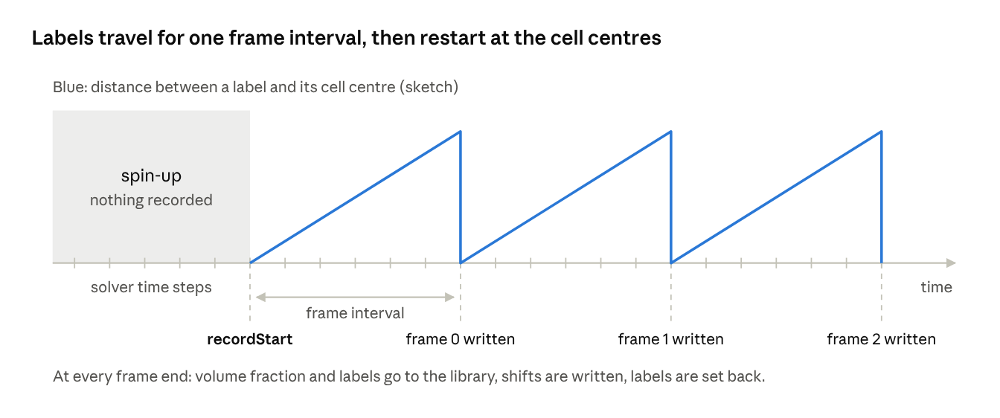

*Figure 7. Time line of the recording, three frames shown.*

### Topology of one processor

The library wants, per processor: its own cells, copies of the neighbour cells behind the partition (corona or external cells), the faces between own cells and the partition faces.

| Library quantity | Source in OpenFOAM |
| --- | --- |
| own cells: centre, volume | `mesh.cellCentres()`, `mesh.cellVolumes()` |
| faces between own cells: c0, c1, area vector | `owner`, `neighbour`, `faceAreas` of the internal faces |
| partition faces | all faces of the processor patches (`processorPolyPatch`), c0 = `faceOwner`, area vector pointing out of the own cell |
| corona cells | the distinct cells behind the partition faces; centre, volume and global index fetched from the neighbour with `syncTools::swapBoundaryCellList`; ordered by owner processor, then by global index |
| host of a cell | `Pstream::myProcNo()` for own cells, `neighbProcNo()` of the patch for corona cells |
| global cell index | `cellProcAddressing` of the processor mesh (identity in a serial run) |

The corona copy carries bit-identical centre and volume of the owner cell because the values are transferred, not recomputed. The coupling checks this, and that every partition face exists on two processors with opposite area vectors (they agree to 1e-16; each processor computes the area from its own point order).

### Frame hand-over

At a frame time the function object collects, for own and corona cells, the volume fraction of every phase (clipped to 0..1, one where there is no fraction field) and the three labels of every phase, and calls `rcfd_of_prep_frame`. Corona values come again from `swapBoundaryCellList`. With `writeFields yes` the displacement (cell centre minus label) is stored as `rCFDdisplacement.<phase>` and written at write times.

## 2.5 Coupling, user headers and the run program

Four small pieces of C connect OpenFOAM, the user headers and the library; each replaces one role of the Fluent glue.

### The coupling for the preparation: `rcfd_of_bridge.c`

Three functions, called by the function object:

| Function | Does |
| --- | --- |
| `rcfd_of_prep_open(mesh, settings, info)` | copies and checks the mesh arrays; opens the library; registers the topology functions; loads `librCFD_user_prep.so` and calls its `user_register_functions`; `rcfd_init` in preparation mode; reads back frames, frame interval, phases; writes `data/topo` and `data/rcfd_foam_prep.txt` |
| `rcfd_of_prep_frame(vof, origin)` | `rcfd_set_vof`, `rcfd_set_displacement_fields` per phase, `rcfd_create_shifts_from_displacement_fields`, `rcfd_interpolate_shifts`, `rcfd_set_fields` (norm), `rcfd_write_fields`, `rcfd_write_shifts`; prints the frame line |
| `rcfd_of_prep_close()` | `rcfd_write_recurrence`, `rcfd_close`; checks that all database files exist |

These are the library calls the Fluent preparation UDF makes, in the same order.

| Point | Solution |
| --- | --- |
| settings | none in the coupling: all dictionary values come from the user header. Only `shifts_from_displacement_fields_on = 1` and `time_steps_per_monitoring_interval = 1` are set after the user's `user_set_solver_dict`, because the function object delivers one set of labels per frame |
| topology | the library gets cells, faces and hosts through `user_init_cells`, `user_init_faces`, `user_init_cell_hosts`; `user_set_cell_dict` and `user_set_face_dict` of the header reach the same data through `fluent_set_cell_dict` and `fluent_set_face_dict` |
| bounding box | eight pseudo nodes, the box of the cell centres padded by the largest cell size. Without nodes the library takes the box of the centres and tests origins against it with strict inequalities, so an origin within half a cell of a wall would miss its own processor |
| checks before the library starts | every global cell owned by exactly one processor; corona copies identical to their owners; every corona cell connected by a partition face; partition faces even in number with cancelling area vectors |
| files for the run mode | `data/topo/topo_<rank>` in the library's own text format, `gid_<rank>.bin` and `cell_rank.bin` with the global cell numbers, `meta.txt` |
| floating-point traps | OpenFOAM enables them (`FOAM_SIGFPE`); the library is not written for that. `feholdexcept` and `fesetenv` switch them off inside the three functions |
| MPI | the library uses `MPI_COMM_WORLD` of the `foamRun` process; in a serial run the coupling initialises and finalises MPI itself |
| exported symbols | a linker version script exports only names beginning with `rcfd_`, so library internals cannot collide with OpenFOAM symbols |
| interpolation switch | the library offers no getter for `interpolation_on`; the first call of `rcfd_interpolate_shifts` shows whether it is on |

### Compiling a user header: `udf.h`, `rcfd_user_wrap.c`, `rcfd_compile`

A Fluent header is not self-contained: it relies on `udf.h` and on the UDF source that includes it. `rcfd_user_wrap.c` is that source here:

```
#include "udf.h"                 /* the stand-in of this package */
#include "rCFD_library.h"
int myid = 0;
#include RCFD_USER_HEADER        /* "rCFD_user_prep.h" or "rCFD_user_run.h" */

void rcfd_user_register_functions(void *handle)
{
    MPI_Comm_rank(MPI_COMM_WORLD, &myid);
    user_register_functions(handle);
}
```

`REGISTER_RCFD_UDF(f)` expands to `rcfd_foam_register(handle, "f", f)`. In the preparation build this goes to the coupling, in the run build to the run program. Both pass every function on to `rcfd_register_user_function` of the library, with two exceptions: the solver dictionary function is kept and called from a wrapper that then sets the properties named above, and topology functions that do not apply are ignored with a note.

`rcfd_compile` runs two compiler calls:

```
mpicc -O2 -Wall -fPIC -shared -DRCFD_STANDALONE -DRCFD_LIB_MPI -DRCFD_USER_PREP \
      -DRCFD_USER_HEADER='"rCFD_user_prep.h"' -I<pkg>/user -I<pkg>/lib -I<pkg>/src -IrCFD \
      <pkg>/user/rcfd_user_wrap.c -L$FOAM_USER_LIBBIN -lrcfdOF -o rCFD/librCFD_user_prep.so

mpicc -O2 -Wall -DRCFD_STANDALONE -DRCFD_LIB_MPI -DRCFD_USER_RUN \
      -DRCFD_USER_HEADER='"rCFD_user_run.h"' -I<pkg>/user -I<pkg>/lib -I<pkg>/src -IrCFD \
      <pkg>/user/rcfd_user_wrap.c <pkg>/build/rcfd_run_main.o <pkg>/build/rCFD_library.o \
      <pkg>/build/tomlc17.o -lm -o rCFD/rcfd_run
```

The header is compiled in its own translation unit, so its enums and macros cannot clash with the run program.

### The run program: `rcfd_run_main.c`

| Step | What it does |
| --- | --- |
| start | reads `data/topo` of its rank and checks ownership; reads partitions and frames from `data/rcfd_db.meta.toml` and the preparation values from `data/rcfd_foam_prep.txt` |
| library | `rcfd_open`, registration of the run header, `rcfd_init` in run mode (the library reads `data/topo` itself), comparison of frames, phases and time step with the database, check of the recurrence path, `rcfd_read_db` |
| loop | `rcfd_run` once per step; every `-snap` steps a snapshot |
| snapshot | per phase the volume fraction and every data, then the arrays of `rcfd_user_field`; gathered to rank 0 and written in OpenFOAM cell order with `gid_<rank>.bin` |
| end | `rcfd_close`, timing and memory |

`shifts_from_displacement_fields_on` is set to 1 after the user's solver dictionary function. It has no effect on the run; with 0 the library allocates an array with `sizeof(short)` and clears it with `sizeof(int)` (`rCFD_init.h:559`, `rCFD_defaults.h:230`).

### Build: `Allwmake`

1. Compiles `rCFD_library.c`, `tomlc17.c` and the coupling with `mpicc -O2 -fPIC` and links `librcfdOF.so` with the version script.
2. Compiles `rcfd_run_main.c` to an object for `rcfd_compile`.
3. Installs `rcfd_compile` with the package path written into it.
4. `wmake libso functionObject`.

The C parts are built with `mpicc` directly, not through wmake, so that their flags are the ones they were tested with.

## 2.6 The rCFD library

No line of the library was changed for OpenFOAM. `lib/` is the state of your `src_opt_fable_mpifix` folder: rCFD-PFM 26.03.0 plus the TUHH changes made before the port. They are marked `TUHH 11/2026` in the source.

### What that state contains beyond the original source

| File | Change | Effect |
| --- | --- | --- |
| `rCFD_swap.h` | drift across partition boundaries: every processor evaluates the flux of each face it holds, applies it to its own cells only, then refreshes the corona copies | each boundary flux counted once; drift independent of the partitioning |
| `rCFD_swap.h` | a face drifts only if both cells are above `vof_cutoff_limit` | closes a species-mass leak at the bed surface |
| `rCFD_swap.h`, `rCFD_types.h` | `local_drift_on` 2 and 3 (local square and linear law with the local Sauter diameter), `conservative_drift_on`, `hindered_drift_on` 2 with `drift_dilute_vof` | optional drift models; off by default |
| `rCFD_parallel.h` | owner of a corona cell found by exact match, else nearest cell within 0.45 cell sizes; cells without owner keep their values and their boundary faces are closed | no access at index -1; no one-sided exchange |
| `rCFD_parallel.h` | volume fraction of all frames and the cell volume mapped to the corona cells at initialisation | drift and face swaps across partitions see real values |
| `rCFD_topo.h`, `rCFD_init.h` | `topo_orient_face_areas`: every area vector points from c0 to c1 | correct drift direction at partition faces |
| `rCFD_balance.h` | the two cells of a face were not swapped in `set_data_swap` | half of the faces were never corrected |
| `rCFD_defaults.h` | a missing `local_diff` file sets the field to zero instead of aborting with the field uninitialised |  |
| `rCFD_report.h` | missing comma in the list of report categories | category names were shifted |
| `rCFD_shift.h` | checked allocation and a per-frame buffer that was never freed | memory |
| `rCFD_library.c` | diagnostics `[c2c]` and `[stage]`, no effect on results | below |

### Diagnostics in run mode

- `[c2c]`, first four steps: per processor, where the shifts of the solids take their data from (own cells, corona cells, other processors), with the share of the weight by distance 0-5, 5-10, 10-20, 20-50 and above 50 mm, and a check of the shift result against the lists (must be about 1e-16). Files `rCFD_c2c_step<S>_node<N>.txt` hold the lists of steps 1 and 2 for processors 1, 3 and 5.
- `[stage]`: per step and phase, the change of the global and per-processor inventory of each species after shift, swap, drift and balance, and the range of the concentration sum.

These lines found the wrong replay database and are the quickest check of a new one: sources within a few cell sizes, shifts from other processors present.

### Library behaviour the coupling works around

| Where | Behaviour | Handling |
| --- | --- | --- |
| `rCFD_topo.h:1095`, `rCFD_utilities.h:25`, `rCFD_prepare.h:623` | bounding box of a processor from cell centres, tested with strict inequalities | padded pseudo nodes from the coupling |
| `rCFD_init.h:559`, `rCFD_defaults.h:230` | array allocated with `sizeof(short)`, cleared with `sizeof(int)` when `shifts_from_displacement_fields_on` is 0 | the switch is set to 1 in preparation and run |
| `rcfd_interpolate_shifts` | returns -1 when interpolation is off; no getter for the switch | first call decides |
| single phase | no vof files, `rcfd_get_cell_vof` returns nothing | `rcfd_is_vof_on` checked; volume fraction one in the output |

### Seen in the library and left alone

- Preparation keeps some memory per frame (`rCFD_parallel.h:209`, list allocated in `rCFD_prepare.h:449`): about 1 GB for 5e5 cells, 16 processors and 320 frames.
- `shift_fill`: a cell without shift whose neighbour has none either ends with all species zero (0/0 in the fill); a later shift that pulls from it gets a concentration sum below one.
- `rCFD_prepare.h:555` (index), `:804` (length of a `memset`), `:985` (integer cutoff), `:1601` and `:1613` (loops that start at the second direction).
- The acceptance radius of a primary shift is that of the equivalent sphere of the cell, which is large for meshes one cell thick.
- The balance correction works on the faces inside a processor only; what it repairs, it repairs in a partition-dependent way (differences of the order 1e-2 between 1 and N processors; with the correction off they agree to round-off).

## 2.7 Verification

OpenFOAM-13 was built from the 13-master source in the work environment (gcc 13, Open MPI 4.1), so every part was compiled and run there before delivery. Not tested: your HPC, your -dev build beyond compiling, meshes other than the two below, a real single-phase solver.

| Test | Set-up | Result |
| --- | --- | --- |
| build | `wmake`, `rcfd_compile` | no errors or warnings |
| coupling against the file-based chain | same frames through memory and through files, 4 processors, 80 frames | database files identical |
| label transport, exact reference | prescribed vortex in a 0.3 m box, 60 x 60 cells, frame 0.025 s, exact back-trace by Runge-Kutta | error 0.2 to 0.3 % of the displacement with `limitedLinear 1` at Courant 0.05 to 0.1; chart below |
| single phase | same vortex, `alpha none; flux phi;` | error 0.2 %; run mode: tracer total 0.5000 throughout |
| topology | fluidisedBed, 4 processors, independent Python check against the mesh | 6000 cells, 180 corona cells, 90 partition faces each on two processors; centres and volumes equal to a from-scratch computation to 1e-13; area vectors opposite to 1.4e-16 |
| labels against the solver's velocity | fluidisedBed, frames of 0.01 s, displacement field against velocity x interval | rms 5.17 mm against 5.24 mm, correlation 0.97 to 0.99 |
| labels against an independent back-trace | fluidisedBed, 8 frames of 0.025 s, velocity files every 5 ms traced back by the Python chain | solids 18.42 mm against 18.46 mm rms, difference 2.05 mm (0.4 cell), correlation 0.98 / 0.99; gas 28.13 against 28.25 mm, correlation 0.99 / 1.00 |
| shifts across processors | fluidisedBed, 4 processors, 80 frames of 0.025 s | 1 230 804 solids shifts, 49 125 from other processors; in the diagnostic printout of step 2, 3.4 % of the weight of processor 1 comes from cells of other processors, all sources within 50 mm |
| partition locking | tracer starting in processor 0 only, no drift, balance correction on | same tracer fraction in all four processors after about 6 s; total constant to 0.1 %; chart in section 1.6 |
| run program | example header against the earlier fixed two-fraction program, same database | snapshots identical (difference 0) |
| Fluent header | `rCFD_user_run_simple.h` with its two Fluent-thread blocks guarded | runs; agrees to 1e-5 |
| species count | three size classes by editing the example header | fine class rises, coarse settles |
| restart | CFD restarted at `recordStart` | recording from the first step, 8 of 8 frames |
| repeatability | parallel CFD run twice | identical shift counts |
| cost | fluidisedBed, 4 s | label transport 2 % of the CPU time |
| label sub-steps (r3) | vortex test with a solver step of half a frame and of a whole frame | error 7 to 14 % without, 1 % with labelMaxCo 0.5, 0.2 % with 0.1; unchanged result where no sub-step is needed (table in section 2.4) |
| stirred tank with MRF, snappy mesh, gas inlet (r3) | aeratedStirredTankMRF, 254 464 cells, 4 processors, 8 frames during the start-up, species fed at the sparger | snapshot numbering equal to the reconstructed mesh (8e-8); tagged gas per step 0.43 to 0.47 L against 0.467 L fed; head-space gas stays untagged; details in section 1.9 |

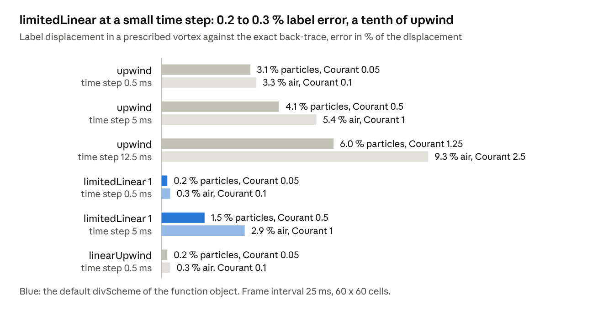

*Figure 8. Vortex test in the test environment, six combinations of scheme and time step, two phases each.*

How to read the three label tests: the vortex test measures the discretisation alone. The comparison with the solver's velocity shows that the labels follow the solid motion the solver computed, which the replay labels did not. The back-trace comparison checks the same against a method that shares no code with the function object; its 2 mm difference contains the errors of both methods.

## 2.8 Limits and open points

The preparation is integrated in OpenFOAM; the run mode is a separate program and its output goes through a conversion.

| Topic | State |
| --- | --- |
| mesh | static only; periodic sides without rotation supported from r4, other coupled patches refused |
| phases | any number up to 8 with an Eulerian flux each; Lagrangian or DEM solids cannot be recorded |
| decomposition | the run must use the processors of the preparation; every processor needs a cell and a face |
| restart inside the recording window | starts the database again |
| layers, islands, several states | the library's multi-layer and island features are not driven by the coupling; one layer, one state |
| local diffusion, recurrence user data | the function object hands over volume fractions and labels only; no diffusivity fields (`local_diff`) and no `rec_user` data |
| recurrence norm | volume fraction of one phase (`normPhase`); irrelevant for `replay`, relevant for the jump formats |
| run-mode output | snapshots and `snap_to_foam.py`; no native OpenFOAM field output, no ParaView reader for the snapshots |
| field names | `c<i>.<phase>`; names taken from the header (proposed, not built) |
| frame interval below one cell of displacement | not tested by me (your 5 ms database ran, with near-zero drift) |
| checkerboard patch in the drift run | seen near the bottom with k\_d = 2e5 at 25 ms; not investigated |
| first package | superseded; its databases work with the new run program |
| Fluent replay repair (`prep_backtrace`) | written, never run in Fluent |
| your granulation and residence-time headers | not ported; expected to need the same edit as the simple header |
| large displacements (rotating zones) | the library searches all cells of a processor for the source cell: 56 to 97 s per frame for 250 000 cells on 2 cores, more than the CFD of the frame; not changed |
| stirred tank at steady state | not run by me: only 8 frames of the start-up; frame interval not optimised; outlet and long runs untested |
| inlets | fixed value in the cells at the patch, set by the run header; the first step after a change of the inlet value tags too little (0.10 L instead of 0.47 L in the test) |

## 2.9 Changes to the code, and why

The rCFD library itself (`lib/`, rCFD-PFM 26.03.0 with the TUHH changes) has not been changed in any release, and neither have the Python tools in `py/`. Shift, swap, balance and the recurrence search are the same code as in Fluent rCFD. Every change listed here is in the layer between OpenFOAM and the library: the function object, the bridge, the run program and the user wrapper. If a result differs from Fluent rCFD, look for the cause in that layer or in the database, not in the library.

### Release r2

| Change | Files | Why |
| --- | --- | --- |
| `rcfd_compile` stores checksum and size of the user header in the build. `rcfd_run` and the function object stop with a message when the header beside the build is not the one that was compiled. | `bin/rcfd_compile`, `user/rcfd_user_wrap.c`, `src/rcfd_of_common.h`, `src/rcfd_run_main.c`, `src/rcfd_of_bridge.c` | A header edited without a new `rcfd_compile` ran the old code without any message. This is how the left/right initialisation was not visible in the results. |

The species shown in the freeboard (an initial value set in cells without solids) needed no package change. Where the initial value is set is decided in `user_init_data` of the run header, which belongs to the case.

### Release r3

| Change | Files | Why |
| --- | --- | --- |
| Label sub-steps: the position labels are transported in N implicit sub-steps per time step, N from the label Courant number (`labelMaxCo`, default 1; `maxLabelSubCycles`, default 200). | `functionObject/rCFDPrep.H`, `functionObject/rCFDPrep.C` | One implicit step per time step smears the labels when a phase crosses several cells per step. In the stirred tank (Courant number 30 to 36 in the rotor zone) the origin points lay up to 12 m away in a tank of 1 m. With sub-steps the displacements are sound (HPC run: 73 mm rms, 227 mm maximum per 25 ms). |
| Patch faces are written to the database (`data/topo/patches_<rank>`) and are available in the run header through `rcfd_patch_faces`. | `functionObject/rCFDPrep.C`, `src/rcfd_run_main.c`, `user/udf.h`, `user/rcfd_user_wrap.c` | Inlets and outlets could only be found by coordinates. The gas species of the stirred tank needs the cells at the sparger and at the outlet. |
| The database is closed in the destructor as well, and a recording that stops early stays usable: recurrence path for the frames written, and a message with the `number_of_frames` to set. | `functionObject/rCFDPrep.C`, `src/rcfd_of_bridge.c` | OpenFOAM skips the `end()` call when `endTime` is changed during the run, and a job that reaches its wall time never gets there. In both cases the frames were on disk but the database could not be used. |
| A clear message when `cellProcAddressing` is missing. | `functionObject/rCFDPrep.C` | A mesh made in parallel by snappyHexMesh without `reconstructPar` stopped the recording without an explanation. |
| Tutorial `aeratedStirredTank`. | `tutorial/aeratedStirredTank/` | Second multiphase case, species in the gas, open system. |

### Release r4

| Change | Files | Why |
| --- | --- | --- |
| Periodic sides: `cyclic` patches and non-conformal couples with a translation. The labels are transported as displacements (`labelForm auto`), an origin beyond a side is moved to the other side of the domain, and behind every side the library gets copies of the cells on the other side as neighbours for the interpolation (`periodicImages yes`). The copies are taken out of the database again. | `functionObject/rCFDPrep.H`, `functionObject/rCFDPrep.C`, `src/rcfd_of_bridge.c`, `src/rcfd_of_bridge.h`, `src/rcfd_of_images.h` (new), `src/rcfd_of_common.h` | The position jumps across a periodic side, so a position label cannot be transported across it. The lattice case is periodic in two directions. |
| Boundary values and faces are taken from the finite-volume patches, no longer from the patches of the polyhedral mesh. | `functionObject/rCFDPrep.H`, `functionObject/rCFDPrep.C` | The coupled faces of a non-conformal couple exist only in the finite-volume mesh, and one cell can face several cells there. |
| A non-conformal couple without transformation connects the cells on its two sides like the cells on the two sides of a face. | `functionObject/rCFDPrep.C` | Interfaces between separately meshed parts. |
| In the run the two sides of a periodic patch are connected by ordinary faces; `data/topo/periodic_<rank>` holds the true distance of the cell centres. New calls for the run header: `rcfd_face_distance`, `rcfd_update_corona`. | `src/rcfd_of_images.h`, `src/rcfd_run_main.c`, `user/udf.h`, `user/rcfd_user_wrap.c` | Diffusion in the run header across all faces, including periodic sides and processor boundaries. |
| Tutorial `latticeReactions`. | `tutorial/latticeReactions/` | Steady single-phase flow with diffusion and reactions; frozen-flow recording. |

Displacement form: with the position label X = x + ξ the transport equation of X becomes an equation for the displacement ξ with a source from the faces of each cell,

```latex
\frac{\partial (m\,\xi)}{\partial t} + \nabla\cdot(F\,\xi) - \xi\,\mathrm{contErr} = -\frac{1}{V}\sum_f F_f\,(x_f - x_c)
```

ξ is continuous across a periodic side, X is not. Faces of boundary patches add nothing to the sum, which is the zero-gradient condition of X.

Checks of r4 in the test environment:

| Check | Result |
| --- | --- |
| fluidisedBed, 40 frames, r3 against r4 | Shift, volume-fraction and topology files identical byte by byte. |
| Periodic box, uniform oblique flow, two blocks with 12 x 12 and 18 x 18 faces at the periodic sides and at the interface between them (non-conformal), 4 processors | Displacement exact in every cell (106.30 mm rms and maximum). Mean position of the sources of a cell off by 0.2 % of the displacement, at the sides as elsewhere, for a displacement of a whole number of cells. |
| latticeReactions with cyclic sides and with non-conformal sides | 816 886 and 816 892 shifts per frame; outlet values equal to four digits. |

Not tested in r4: periodic sides with more than one phase, the aerated stirred tank, drift and `local_diff_on` across periodic sides (the library takes the distance of the cell centres, which is wrong across a side). Databases of cases without periodic sides do not change.

### Release r5

| Change | Files | Why |
| --- | --- | --- |
| New call for the run header: `rcfd_update_corona_field(handle, array)` fills the copies of the cells of the neighbour processors for an array of the header with one value per cell. | `src/rcfd_run_main.c`, `user/udf.h`, `user/rcfd_user_wrap.c` | An iterative solver written in the header needs its search direction in the neighbour cells. |
| `latticeReactions`: implicit diffusion step with the wall reaction (`_diffusion_in_header 2`, `diffuse_and_react_implicit`), one conjugate-gradient solve per species and sub-step. The explicit sub-steps stay the default of the tutorial. | `tutorial/latticeReactions/rCFD/rCFD_user_run.h` | The explicit sub-step scales with the square of the smallest cell. The 16 million cell lattice mesh has wall cells of about 1 µm (smallest cell volume 7.8e-17 m3): the explicit sub-step would be below a microsecond. |
| `latticeReactions`: `residualControl` moved to the `PIMPLE` dictionary, where the solver modules of OpenFOAM-13 read it. | `tutorial/latticeReactions/system.flow/fvSolution` | The steady flow ran all 1500 iterations; it now stops at convergence (251 iterations). |
| `py/rcfd_monitor.py`: pictures of a running or finished run. | `py/rcfd_monitor.py` | Monitors and the `[c2c]` lines of the log as one picture. |
| Case `fischerK_of13`: the 16 million cell lattice case in two jobs (mesh conversion and steady flow; recording and rCFD run). | `tutorial/fischerK_of13/` | Job 1 ran on the cluster: 614 iterations in 595 s on 64 processes. |

Implicit step in the small lattice, frames of 20 ms, E at the outlet after 4 s: 0.457, 0.462, 0.466, 0.467 with 1, 2, 4, 8 sub-steps per step; 0.470 with the explicit sub-steps; 0.4765 in the reference. The step is first order in time.

### What this means for existing work

- With a label Courant number of 1 or less, r3 uses the same code path as r2 and records the same database. Above 1 it now takes sub-steps, so a fluidised-bed database recorded with r3 can differ slightly from one recorded with r2. The log line `label Courant number up to ...` of each frame shows which case applies.
- A database recorded with r2 still runs with r3. It has no patch files, so `rcfd_patch_faces` reports that the patches are not available.
- After installing a new release, run `rcfd_compile` in every case again. The header check refuses a build made with another header, not one made with an older package.

# Part 3 — How rCFD works

## 3.1 The idea of recurrence CFD

rCFD separates the expensive part of a simulation, the flow, from the cheap part, the transport of passive quantities by that flow, and computes the expensive part only once for a short window.

Many processes have a flow that repeats in a statistical sense (bubbling, sloshing, an impeller turning) and quantities that develop slowly on top of it (mixing, segregation, heat, moisture, reaction, residence time). A conventional simulation has to resolve the fast flow for the whole slow process. rCFD records the flow for a window of some periods and then replays it for as long as the slow process takes.

What is recorded is not the velocity field but its effect on material over one frame interval: for every cell, from which cells its content came. These cell-to-cell shifts are a Lagrangian description of convection stored on the Eulerian mesh. Applying the shifts of one frame to any scalar field moves that field as the flow would have moved it during that interval, without solving an equation.

### Two modes

| Mode | Input | Does | Output |
| --- | --- | --- | --- |
| preparation | a running CFD simulation | every frame interval: position labels to shifts, volume fractions, a recurrence norm | the database: one set of shifts and volume fractions per frame, and the recurrence path |
| run | the database, a user header with species and models | per rCFD time step: pick a frame, shift, diffuse, drift, user models, mass balance | fields of every species over time |

The rCFD time step equals the frame interval. One run step costs a pass over the shift list and the faces, here 3 ms for 6000 cells and 2 phases on 4 processors, against about 2 s of CFD for the same 25 ms in the same environment.

### Terms

| Term | Meaning |
| --- | --- |
| frame | the recorded state of one frame interval: shifts and volume fractions |
| shift (cell-to-cell, c2c) | "cell c1 receives from cell c0 with weight w"; mimics convection |
| c0, c1 | source and target cell of a shift; also the two cells of a face |
| primary shift | the one shift per cell from the nearest cell to its origin point |
| interpolated shifts | up to four shifts per cell whose weighted source positions reproduce the origin point |
| swap (face swap) | exchange between the two cells of a face; mimics diffusion |
| drift | a relative motion of a species against its phase, applied through faces |
| norm | a number or vector per frame that measures how similar two frames are |
| sequence, jump | a run of consecutive frames; the change to another, similar frame |
| state, layer, island | several databases, several mesh resolutions, sub-regions with their own recurrence; not used by this coupling |
| internal and external (corona) cells | the cells of a processor, and copies of the neighbour cells behind its boundary |
| host | the processor that owns a cell |
| phase, data | a phase of the CFD; a species or other scalar carried by a phase |

## 3.2 Preparation: from position labels to shifts

For every cell and frame the preparation answers one question: where was the material that is now in this cell one frame interval ago? The answer is stored as one to four source cells with weights.

### Step 1: position labels

Three scalars per phase are transported with the phase like a dye. At the start of a frame each is set to the cell coordinate (x, y or z of the cell centre). At the end of the frame the three values of a cell form the origin point: the mean position its present content had at the start. Cell centre minus origin point is the displacement over the frame. In Fluent the scalars are user-defined scalars; in OpenFOAM the fields of `rCFDPrep` (section 2.4). The library receives them through `rcfd_set_displacement_fields` as absolute positions, together with the volume fractions (`rcfd_set_vof`).

### Step 2: primary shifts

`rcfd_create_shifts_from_displacement_fields` looks, for every target cell c1 in which the phase is present (volume fraction above `vof_cutoff_limit`), for the source cell c0 whose centre is nearest to the origin point:

1. Among the neighbour cells of c1 within a search radius (`next_neigh_cell_skin_factor` times the cell size). The candidate is accepted if the origin lies within the radius of the equivalent sphere of that cell.
2. Otherwise among all cells of the processor.
3. Otherwise on other processors: the origin is offered to every processor whose bounding box contains it, and the nearest cell found there becomes the source. Such a shift is stored with the source processor (an incoming shift).

A primary shift has weight one. With primary shifts alone a cell takes the whole content of one source cell, which quantises displacements to whole cells.

### Step 3: interpolated shifts

`rcfd_interpolate_shifts` (with `interpolation_on`) replaces the primary shift by up to four shifts. Around the primary source it looks for aligned neighbours: cells whose centres enclose the origin point, so that the origin can be interpolated rather than extrapolated. If three or more are found, weights are computed such that the weighted source centres reproduce the origin point. The weights are then multiplied with the volume fraction of the phase in each source cell (a source that holds little of the phase contributes little) and stored as one byte each (0 to 255).

In detail: the vector from the primary source to the origin point is written as a combination of the vectors to three aligned neighbours (a 3 x 3 system); if all four weights are positive the cell gets four shifts. If not, which is always so in a case one cell thick, the origin is projected onto the plane or line spanned by fewer neighbours and the cell gets three or two shifts. In the tutorial (2D): 4553 cells with solids, 13 649 shifts in one frame.

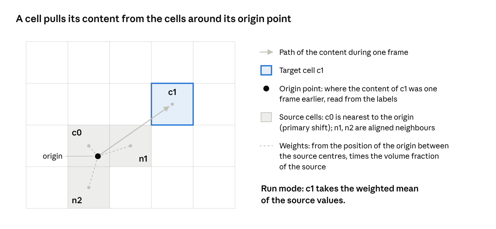

*Figure 9. Sketch of one interpolated shift in a two-dimensional mesh.*

### Step 4: what is written per frame

| Call | Writes |
| --- | --- |
| `rcfd_write_shifts` | the shifts of every phase, appended to `c2c_<state>_<phase>_<rank>`; advances the frame counter |
| `rcfd_set_fields`, `rcfd_write_fields` | the volume fractions (`vof_...`) and the recurrence norm (`norm_...`); optionally local diffusivity and recurrence user data |

### Step 5: recurrence

After the last frame `rcfd_write_recurrence` compares the norms of all frames, builds the recurrence matrix and writes the path file (section 3.5). `rcfd_close` writes `rcfd_db.meta.toml`.

### Why the flux matters

The shifts are only as good as the labels. A label transported with a flux that does not belong to the recorded volume fractions describes some other motion; the shifts then move species where the phase did not go. This was the defect of the replay databases (section 2.1) and is why the function object uses the flux the solver itself advanced the phase with.

## 3.3 The database

The database is a folder of per-processor files; for the tutorial (6000 cells, 2 phases, 80 frames, 4 processors) it takes 45 MB. Everything except the shift files is text.

| File | Format | Content |
| --- | --- | --- |
| `data/c2c/c2c_<state>_<phase>_<rank>` | binary | for each frame: number of internal shifts, number of incoming shifts, then the shift records |
| `data/vof/vof_<state>_<phase>_<rank>` | text | for each frame: cell count, then the volume fraction of the phase in every cell |
| `data/rec/jump_<state0>_<state1>_<island>` | text | for each frame: the frame the path continues with |
| `data/rec/matrix_...`, `jump_diff_...` | text | recurrence matrix and the norm difference of each jump |
| `data/tmp/norm_<state>_<rank>` | text | for each frame: the norm values of this processor |
| `data/topo/topo_<rank>` | text | cells, faces, optional nodes of the processor (below) |
| `data/rcfd_db.meta.toml` | TOML | version, number of partitions and frames, shift file format |
| `data/local_diff/...`, `data/user/...` | text | local diffusivity and recurrence user data, if used |

Added by the OpenFOAM coupling: `data/topo/gid_<rank>.bin` (global cell number of every local cell, 32-bit integers), `data/topo/cell_rank.bin` (processor of every global cell), `data/topo/meta.txt` (cells, processors) and `data/rcfd_foam_prep.txt` (frame interval, frames, phase names).

### Shift records

The format code in the meta file, `0x00010414`, means: weight 1 byte, source processor 1 byte, cell indices 4 bytes.

| Record | Fields | Size |
| --- | --- | --- |
| internal shift | source cell c0 (int), target cell c1 (int), weight (1 byte, w = value / 255) | 9 bytes |
| incoming shift | source cell c0 on its processor (int), source processor (1 byte), target cell c1 (int), weight (1 byte) | 10 bytes |

With more than 256 processors the source processor is stored as an integer. Per frame the file starts with the two counts (two ints).

### Topology file

```
n_cells n_faces n_nodes
x y z volume host            (n_cells lines: internal cells first, then external cells)
c0 c1 Ax Ay Az               (n_faces lines: faces between internal cells first, then partition faces)
[node section, only for the library's own VTK output]
```

A partition face has c0 internal and c1 external, the area vector pointing from c0 to c1, and is listed on both processors.

### What the database does not contain

No species, no densities, no model parameters. The same database serves any number of species and any model in the run header; only frame interval, number of frames, number of phases and the number of processors are fixed by it.

## 3.4 Run mode: one time step

One call of `rcfd_run` advances all species of all phases by one frame interval: choose a frame, move the data along its shifts, mix across faces, apply drift and user models, repair the mass balance. No equation system is solved.

### Sequence of a step

1. **Frame update** (`run_update_frame`): the next frame of the recurrence path becomes current (section 3.5).
2. **`user_access_data_before_phase_loop`**.
3. For every phase:
   1. **`user_access_data_before_shift`**.
   2. **Shift** (`shift_data`): convection.
   3. **Fill** (`shift_fill`): cells no shift has reached.
   4. **Face swaps** (`swap_data`): diffusion, if `face_swap_diffusion_on`.
   5. **Drift** (`swap_drift_data`), if `data_drifting_on`.
   6. **`user_access_data_after_swap`**.
   7. **Balance** (`balance_update`, `balance_correct`): mass integral against its target.
   8. **Concentration sum** (`balance_control_conc_sum`), if `control_conc_sum_on`.
4. **`user_post`**, the library's dump, time and step counter advance.

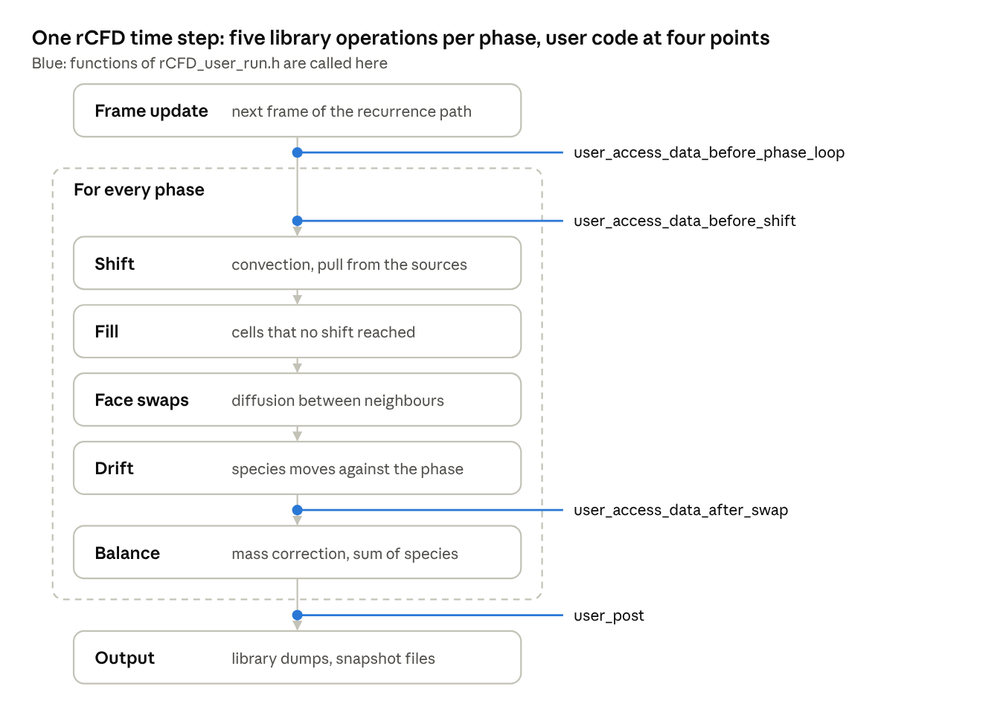

*Figure 10. Sequence of one run step with the four user-function calls.*

### Shift: convection

Every shift of the current frame says: target cell c1 receives from source cell c0 with weight w. For each species the new value of a target cell is the weighted mean of its sources:

```latex
c^{new}(c_1) = \frac{\sum_k w_k \, c^{old}(c_{0,k})}{\sum_k w_k}
```

This is a pull operation: each cell fetches its content. Shifts whose source lies on another processor are served in a second pass (`parallel_shift_data`): the source values are collected, sent and added with the same formula. Because the weights already contain the volume fraction of the sources, the mean is a mass-weighted one.

### Fill

A cell that holds the phase but received no shift takes the weighted mean of its already updated face neighbours; repeated up to `max_fill_loops` (10) times so the values spread inwards.

### Face swaps: diffusion

With the global form (`local_diff_on 0`), every face between cells c0 and c1 exchanges, for each species of type concentration or temperature,

```latex
\Delta m = D \cdot \min(V_0\alpha_0, V_1\alpha_1) \cdot \tfrac{1}{2}\,(c_1 - c_0)
```

where D is `face_swap_diffusion` of the species (dimensionless: the share of the smaller cell content exchanged per step) and V alpha the phase volume in a cell. Values above `face_swap_max_per_loop` (1/8) are split into several loops. The exchange is symmetric, so it conserves the species. With `local_diff_on 1` the exchange volume comes instead from a recorded diffusivity field: diffusivity x face area / cell distance x time step.

### Drift

A species with `drifting_data 1` moves relative to its phase with its `drift_velocity`. Per face and species:

```latex
V_{drift} = \mathbf{u}_{drift}\cdot\mathbf{A}\,\Delta t, \qquad \Delta m = c(\text{donor}) \; V_{drift} \; \alpha(\text{donor}) \; \rho
```

The donor is the cell the drift velocity points away from. Limits: the drift volume cannot exceed the donor cell volume (so a species moves at most one cell per step), the acceptor cannot take more than its free share (1 - c) of its phase mass, and a face drifts only if both cells hold the phase above `vof_cutoff_limit`. Afterwards the other species are adjusted so that the concentrations of a cell sum to one. Options in the phase dictionary: `hindered_drift_on` (less drift in dense or in dilute regions), `local_drift_on` (velocity rescaled with the local Sauter diameter), `conservative_drift_on` (all drifting species exchanged together so that their fluxes cancel exactly).

The example header sets one velocity per size class, `u_i = -k_d (d_i - d32) |d_i - d32|` along the vertical: classes coarser than d32 sink, finer ones rise.

### Balance correction

Shifts are not conservative: a pull with interpolated, quantised weights does not guarantee that what leaves one cell arrives in others in equal amount. The library therefore tracks for every species the mass integral

```latex
M = \sum_{cells} c \; V \; \alpha \; \rho
```

and a target (the initial integral plus the sources announced by the user). The correction distributes the difference over the faces: it sums an available exchange over all faces between cells of different concentration, takes the ratio of the mass error to it, and moves that share from the richer towards the poorer cell (or back), up to `max_correction_loops` times until the error is below `accuracy_level` (0.01). `rCFD_balance.out` lists integral and target per step. The correction acts where concentration gradients are, so it is a small additional mixing; with `max_correction_loops 0` it is off and the integral drifts.

### Concentration sum

With more than one species of type concentration in a phase, each value is clipped to 0..1 and the values of a cell are divided by their sum.

### Where user code acts

| Hook | Typical use |
| --- | --- |
| `user_access_data_before_phase_loop` | sources and sinks (spray, feed, discharge), reactions, exchange between phases |
| `user_access_data_before_shift`, `user_access_data_after_swap` | per-phase models that must act before or after transport |
| `user_post` | integrals, monitors, output arrays |

In all of them the data are plain arrays, `c[i_cell][i_data]`, to read and write.

## 3.5 Recurrence: which frame comes next

The run needs an endless sequence of frames from a finite database. The recurrence path provides it: play consecutive frames for a while, then continue at a frame that looks like the current one.

### Norm and recurrence matrix

During the preparation every frame stores a norm: a small set of numbers that characterises the state of the flow. In this coupling it is the volume fraction of one phase in the cells (subsampled by the library's norm coarsening). After the last frame the library computes the distance between every pair of frames,

```latex
R_{ij} = \sum_k \left| n_k(i) - n_k(j) \right|
```

summed over the norm values k of all processors. R is the recurrence matrix (`data/rec/matrix_...`): small entries away from the diagonal mark frames in which the flow looked alike.

### Path formats

From the matrix a jump target is chosen for every frame and written to `data/rec/jump_...`. The format is `Rec_Dict` `format`:

| Format | Jump target of frame i | Use |
| --- | --- | --- |
| `replay` | frame i + 1; the last frame continues with frame 0 | the recorded window is played in a loop |
| `off_diagonal_band` | the most similar frame at least `off_diagonal_band_width` frames away (default: a tenth of the frames) | recurrent flows: avoids jumping to the immediate neighbours |
| `quarter_jumps` | the most similar frame in another quarter of the database | recurrent flows |

### In the run

`run_update_frame` plays frames in order (frame + 1) until the current sequence is used up, then continues at the jump target of the current frame and draws a new sequence length at random between `min_seq_length` (default: frames / 25) and `max_seq_length` (frames / 4). The last frame of the database always continues at its jump target. With `replay` the jump target is the next frame, so the path is simply 0, 1, ..., N-1, 0, 1, ...

The sequence of frames actually used is written to the recurrence frame file by the library.

### What replay means for results

A replayed window is periodic: every quantity that depends on the flow repeats with the length of the database (2 s in the tutorial; the mean heights in section 1.6 show it). The last frame is followed by the first although the flow did not go there; the shifts of frame 0 then act on a state they were not recorded for. For a statistically steady flow and a window of several periods the effect is small. The jump formats avoid the fixed period but need a norm that really distinguishes flow states and a database long enough to contain recurrences. All tests of this manual used `replay`.

## 3.6 Dictionaries and user functions

All settings of the library live in dictionaries; user functions set them and add model code at fixed points. Nothing is hard-wired to a solver.

### How a program drives the library

| Step | Preparation | Run |
| --- | --- | --- |
| create | `rcfd_open` | `rcfd_open` |
| register user functions | `rcfd_register_user_function` (done by `user_register_functions` of the header) | same |
| initialise | `rcfd_init(handle, RCFD_MODE_PREPARATION)` | `rcfd_init(handle, RCFD_MODE_RUN)` |
| work | per frame: `rcfd_set_vof`, `rcfd_set_displacement_fields`, `rcfd_create_shifts_from_displacement_fields`, `rcfd_interpolate_shifts`, `rcfd_set_fields`, `rcfd_write_fields`, `rcfd_write_shifts` | `rcfd_read_db`, then `rcfd_run` per time step |
| finish | `rcfd_write_recurrence`, `rcfd_close` | `rcfd_close` |

### Dictionaries

| Dictionary | Holds | Examples of properties |
| --- | --- | --- |
| `Solver_Dict` | global settings and switches | `global_time_step`, `number_of_frames`, `number_of_phases`, `vof_cutoff_limit`, `interpolation_on`, `data_convection_on`, `face_swap_diffusion_on`, `data_drifting_on`, `local_diff_on`, `control_conc_sum_on`, `recurrence_process_on`, `report_priority` |
| `Phase_Dict` (per phase) | phase properties | `number_of_data`, `density`, `heat_capacity`, `vof_max`, `hindered_drift_on`, `local_drift_on` |
| `Data_Dict` (per phase and data) | species properties | `type`, `face_swap_diffusion`, `drifting_data`, `drift_velocity`, `d1_diam` |
| `Balance_Dict` (per phase and data) | mass balance | `max_correction_loops`, `accuracy_level` |
| `Rec_Dict` | recurrence | `format`, `min_seq_length`, `max_seq_length`, `off_diagonal_band_width`, `seed` |
| `Prep_Dict`, `Norm_Dict` | preparation details and norm | interpolation settings, `larger_than_mean_norm_only` |
| `Cell_Dict`, `Face_Dict`, `Node_Dict` (per layer) | sizes of the topology | `number_of_int_cells`, `number_of_ext_cells`, `number_of_int_faces`, `number_of_ext_faces`, `next_neigh_cell_skin_factor` |
| `File_Dict`, `Dump_Dict` | file names, the library's own VTK dumps and probes |  |

Properties are set inside the matching user function with

```
rcfd_set_dict_property_i(handle, "Solver_Dict", layer, phase, data, "number_of_frames", 80);   /* integer */
rcfd_set_dict_property_r(handle, "Phase_Dict",  -1, i_phase, -1, "density", 2500.0);          /* real    */
rcfd_set_dict_property_s(handle, "Data_Dict",   -1, i_phase, i_data, "type", "concentration"); /* string  */
rcfd_set_dict_property_r_3d(handle, "Data_Dict", -1, i_phase, i_data, "drift_velocity", v);    /* vector  */
```

with -1 for an index that does not apply. The library also reads a `config.toml` in the case directory with the same properties as key and value tables; a user function overrides it. This coupling does not use the file (the line `Failed to open config file: config.toml` in the transcript is only the library noting its absence).

Order matters in one case: the drift velocity of a species is allocated only if `data_drifting_on` is already 1, so it must be set in `user_set_solver_dict`, which runs before `user_set_data_dict`.

### User functions

| Name | Signature | Called |
| --- | --- | --- |
| `user_set_solver_dict`, `user_set_phase_dict`, `user_set_rec_dict`, `user_set_file_dict`, `user_set_dump_dict` | `(void *handle)` | in `rcfd_init` |
| `user_set_prep_dict`, `user_set_norm_dict` | `(void *handle)` | in `rcfd_init`, preparation only |
| `user_set_data_dict`, `user_set_balance_dict` | `(void *handle)` | in `rcfd_init`, run only |
| `user_set_cell_dict`, `user_set_face_dict`, `user_set_node_dict` | `(void *handle, const short i_layer)` | in `rcfd_init` |
| `user_init_cells`, `user_init_faces`, `user_init_cell_hosts`, `user_init_nodes` | `(void *handle, const short i_layer)` | in `rcfd_init`; here provided by the coupling |
| `user_init_data` | `(void *handle, const short i_layer)` | in `rcfd_init`, run |
| `user_access_data_before_phase_loop` | `(void *handle)` | every run step |
| `user_access_data_before_shift`, `user_access_data_after_swap` | `(void *handle, const short i_phase)` | every run step, per phase |
| `user_post` | `(void *handle)` | in `rcfd_init` and at the end of every run step |
| `user_set_layer` | `short (void *handle, const short layer)` | start of every run step |
| `user_set_norm`, `user_set_rec_vars` | `(void *handle)`, `(void *handle, const short i_layer)` | in `rcfd_set_fields`, preparation |

Only one function can be registered per name; a later registration replaces the earlier one.

### Data types of a species

| `type` | Mass integral | Diffusion and drift |
| --- | --- | --- |
| `concentration` | c x V x alpha x density | face swaps and drift; counted in the concentration sum |
| `temperature` | T x V x alpha x density x heat capacity | face swaps |
| `generic` | value x V x alpha | drift in its own form; no face swaps |
| binary | none | meant to be sharpened to 0 or 1 after the swaps; in this state of the library that step accumulates its result and never applies it |

## 3.7 Parallel topology and numerical properties

### Cells, corona and hosts

Every processor holds its own cells (internal cells, index 0 to `number_of_int_cells` - 1) followed by copies of the cells of neighbouring processors that share a face with it (external or corona cells, `number_of_ext_cells`). A face between two processors is in the face list of both: on each side c0 is the internal cell and c1 the corona copy. For every corona cell the library finds the hosting cell, that is the processor that owns it and the cell index there, by comparing cell centres at start-up (`parallel_find_hosting_cell`).

Values in corona cells are copies. They are refreshed from the hosting cells with `parallel_communicate_data` before each face loop of the swap and the drift, so that a partition face sees the neighbour's current value. The volume fraction of the corona cells is mapped once at start-up, for all frames and phases (log line `parallel_expand_initial_fields: mapped vof of ... to corona cells`).

### Shifts across processors

A frame holds two lists per phase and processor:

| List | Record | Source cell | Applied by |
| --- | --- | --- | --- |
| interior | c0, c1, weight | on this processor (own cell or corona copy) | `shift_local_data` |
| incoming | c0, processor of c0, c1, weight | on another processor | `parallel_shift_data` |

For the incoming list every processor collects the values of the source cells that others ask for, processor 0 gathers them, reorders them by destination and sends each processor its part; the destination then adds weight times value to the target cell as for an interior shift. The route goes through processor 0, so the incoming shifts are the part of a step that does not scale with the number of processors. In the tutorial 3.4 % of the solids shifts are of this kind.

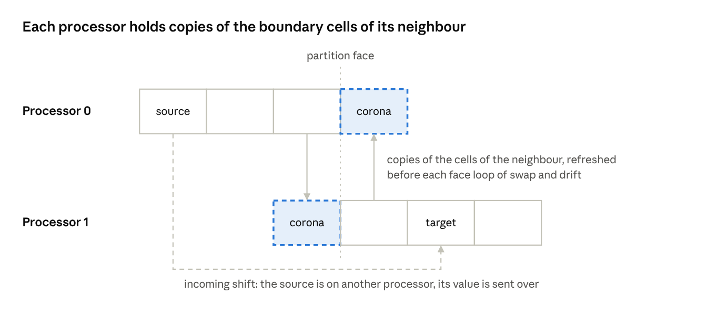

*Figure 11. Sketch of a row of six cells split between two processors.*

The run must use the decomposition of the preparation: cell indices, corona order and processor numbers in the database belong to it. The run program stops with a message if the number of processors differs from that of the database.

### What is conserved and what is not

- **Shift.** A cell pulls a weighted mean from its sources; the weights are normalised per target cell. Nothing guarantees that the mass leaving the source cells equals the mass arriving, so a shift does not conserve species mass on a non-uniform field. On a smooth field the error per step is small; on a field with cell-to-cell scatter single steps were off by up to 8 % with the correction switched off.
- **Face swap and drift.** Both exchange the same mass between the two cells of a face, including partition faces (exchange across partitions balances to round-off), so they conserve.
- **Balance.** `balance_update` sums the mass over all processors and `balance_correct` brings it back to the target within `accuracy_level` (default 0.01, relative) in at most `max_correction_loops` loops. The correction itself works on internal faces only, so what it repairs is repaired per processor. A test case run on 1 and on 16 processors differed by 1.4e-2 after five steps for this reason. Use the same decomposition when comparing two runs in detail.
- **Concentration sum.** With `control_conc_sum_on` the concentration species of a phase are rescaled to sum to one after the balance.

### Numerical diffusion

With interpolation a target cell takes its value from up to four source cells, so a sharp front is spread by about one cell per step it travels; this is the upwind-like diffusion of the method and it grows with the number of steps, not with time. Without interpolation (`interpolation_on 0`) every cell has one source: no spreading, but cells that share a source repeat its value and cells that nobody pulls from lose theirs. `face_swap_diffusion` adds mixing on purpose and is the handle for sub-frame dispersion.

### Limits that matter in practice

- **Drift per step.** The volume a face moves in one step is capped at the volume of the donor cell. A drift velocity times the time step above one cell size is therefore cut. Tutorial: 5 mm cells and 25 ms give 0.2 m/s. With the drift law of the example header, k\_d = 2e5 and 25 ms moved the coarse class 6 mm per step on a mesh with 2.4 to 5 mm cells, which is above the limit; either reduce the frame interval or accept that the drift saturates.
- **Cells without a shift.** `shift_fill` gives a cell that no shift reached the mean of its updated face neighbours, in up to `max_fill_loops` (10) sweeps over the internal faces. A cell without a shift whose neighbour has none either is marked as updated with zero data (0/0 in the fill). This is harmless where the phase is absent, but a later shift that pulls from such a cell gets a concentration sum below one until `control_conc_sum_on` rescales it.
- **Volume fraction cutoff.** Cells below `vof_cutoff_limit` of a phase get no shift for that phase and take no part in swap and drift.
- **Memory in preparation.** The library keeps some memory per frame (`rCFD_parallel.h`), about 1 GB for 5e5 cells, 16 processors and 320 frames.
- **Array sizes.** `malloc_r_3d` computes sizes as `int`; a single array above 2 GB overflows.
